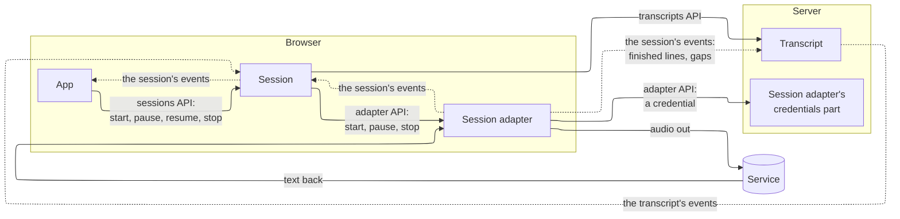
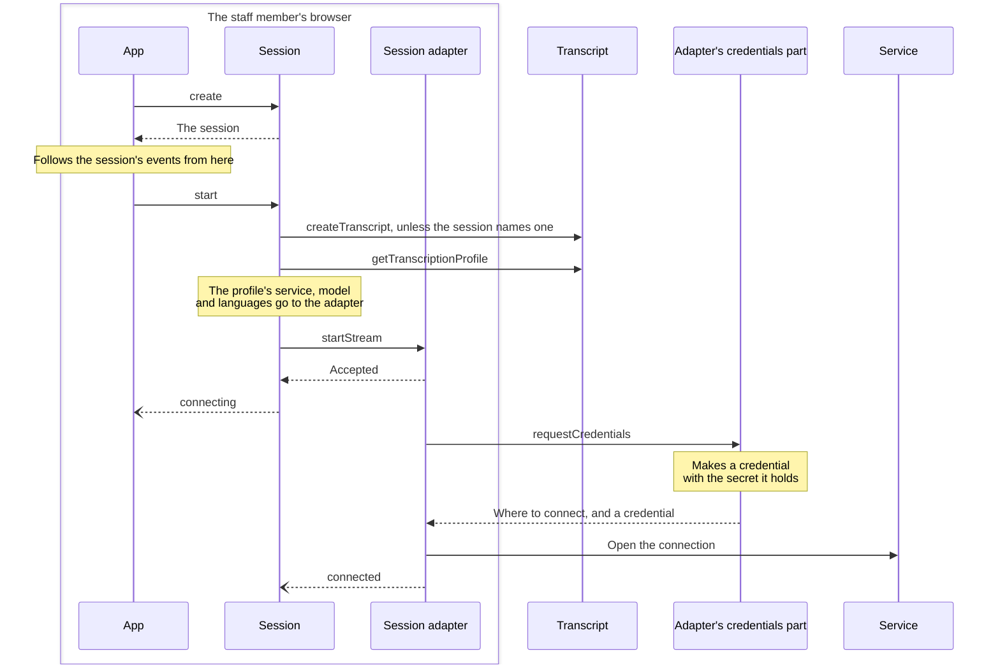
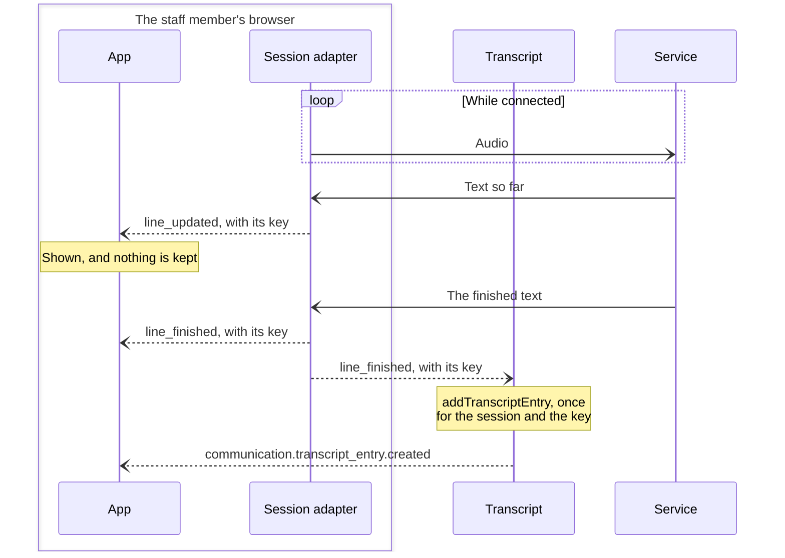
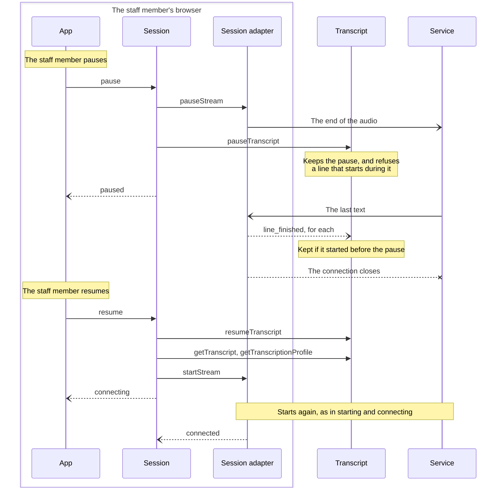
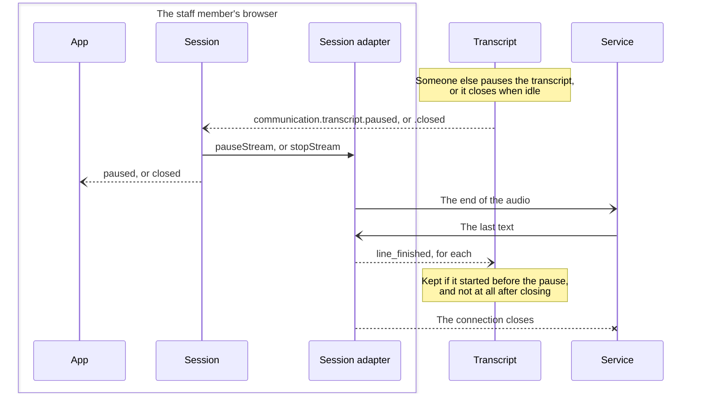
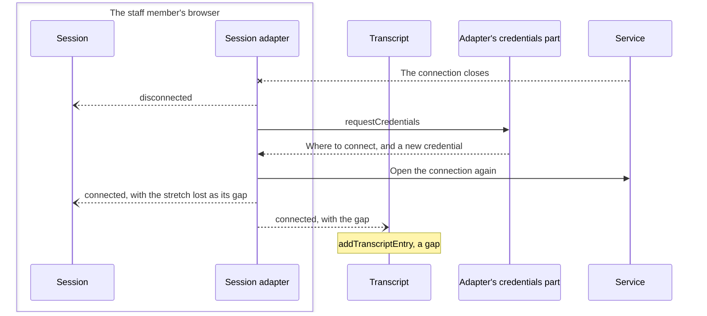
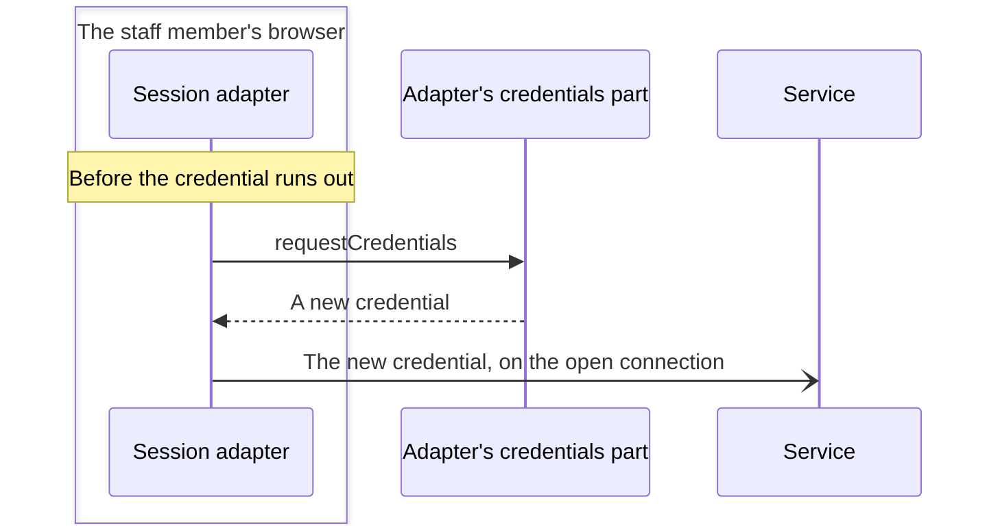
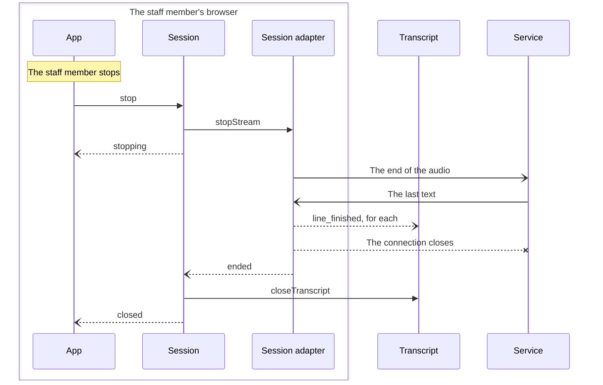

# Communication: Transcripts

> **Status:** Built.

Transcripts are a capability of the framework's [Communication](communication.md)
domain that a contract set opts into. See [AI Services](../cross-cutting/ai-services.md)
for how transcripts fit with suggestions and fact extraction, and
[Contract-Driven Architecture](../contract-driven-architecture.md) for the
contract approach.

## Overview

A transcript is the written record of one conversation: who said what, and
when, including the stretches that were off the record and the stretches that
were lost. It is not tied to audio — a chat or a text-message exchange produces
one too — and everything that comes after it, from fact extraction to the lines
a suggestion cites as evidence, needs only the record, not how it was
captured. The blueprint holds the record and the rules for keeping it; turning
speech into text is done by a transcription service the staff member's
software talks to directly. Transcripts are provided by the framework, and a
contract set includes them by listing the `transcripts` capability
([Decision 1](#decision-1-a-framework-domain-of-its-own)), without taking
anything else the framework adds to the domain.

## What happens during a transcribed conversation

1. A staff member starts a transcript for the conversation — an interview, say —
   under a profile: the transcription service and languages the state chose for
   that kind of conversation. The software begins sending the audio to that
   service.
2. As each sentence is finished, the software reports it, with when it was
   said and who said it, and the transcript keeps it.
3. If the other person asks to go off the record, the staff member pauses the
   transcript. Nothing said while paused is kept. When they resume, recording
   continues.
4. If transcription drops out — a lost connection, a service failure — the
   software records the stretch that was lost once transcription works again.
5. Anyone following along, such as the staff member's own screen, sees each
   change as it happens.
6. When the conversation ends, the staff member stops. Once the last sentence
   is in, the transcript closes, and nothing more is added after that.

## How the parts work together

These parts are for transcribing speech. A video call is transcribed from its
audio, and a conversation through a sign language interpreter from the
interpreter's speech. A typed conversation, such as a chat, needs none of
them: the software adds its lines to the transcript directly, under a profile
with no service.

### The parts, for transcribing speech

The app talks to one thing, the session. The session adapter is the session's
implementation for one transcription service: the session tells it to start,
pause and stop, and it reports what happens by publishing the session's own
events, which the session, the app and the transcript follow — the app
hears the same events whoever publishes them. That's a
[running adapter](../cross-cutting/adapters.md#a-running-adapter). Whether the
adapter streams to a vendor directly, to a server the state runs in front of
one, or to a model in the page is its own business; the session and the app
can't tell.

| Part | API | Defined in | What it does |
|---|---|---|---|
| App | — | — | The software in the browser: the staff member's screen. It calls the session's actions — start, pause, resume, stop — through the SDK generated from the contracts, and follows the session's events ([Decision 16](#decision-16-the-apps-actions-go-in-and-the-adapter-reports-by-publishing-the-sessions-events)). |
| Session | sessions API | `communication-transcription-sessions-openapi.yaml`; its actions, events and reactions in `communication-transcription-sessions-state-machine.yaml` | Keeps track of the connection. Its actions start the transcript, call the transcripts API to pause and resume, and start, pause and stop its adapter; it follows what the adapter publishes, and closes the transcript when the adapter has ended. Usually kept in the page by routing. |
| Session adapter | adapter API: `startStream`, `pauseStream`, `stopStream` | `communication-transcription-sessions-adapter-openapi.yaml` | Code for one transcription service, running in the page: it gets a credential when its service takes one, captures and streams the audio, turns the service's results into lines, reconnects after a drop, renews its credential, and publishes the session's events — `connected`, `line_updated`, `line_finished`, `disconnected`, `failed`, `ended` — with `publishEvent`. One per service: Amazon Transcribe, Deepgram, Google behind a server the state runs, a model in the page. |
| Session adapter's credentials part | adapter API: `requestCredentials` | `communication-transcription-sessions-adapter-openapi.yaml` | Holds the service's secret, so it runs on a server: it answers the streaming part's `requestCredentials` with where to connect and a credential that lasts minutes, after checking the staff member is signed in ([Decision 11](#decision-11-the-adapter-asks-its-credentials-part-how-to-stream-in-one-shape-for-every-service)). Once the streaming part connects, it's out of the picture until a renewal or a reconnect. |
| Transcript | transcripts API | `communication-transcripts-openapi.yaml`; its actions, events and reactions in `communication-transcripts-state-machine.yaml` | Keeps the transcript and its rules. It follows the session's `line_finished` and the gap on `connected`, and keeps each line once ([Decision 17](#decision-17-a-line-in-progress-is-tied-to-its-finished-line-by-the-adapters-key)). Sends every change as an event. |
| Service | service's API | The vendor's documentation, such as [Amazon Transcribe streaming](https://docs.aws.amazon.com/transcribe/latest/dg/streaming.html) | Turns speech into text: Amazon Transcribe, Deepgram, Whisper, a model the state runs. |

All the blueprint's files are in `blueprint-core/base-contracts/domains/communication/`.

Audio goes from the page to the service, or the server the adapter streams to,
and never through the blueprint. Lines in progress are events nothing keeps;
only finished lines are kept. The secret never reaches the page. Every diagram
below starts with the staff member signed in; how they sign in is part of the
security model in [Identity & Access](../cross-cutting/identity-access.md), and
the adapter's credentials part checks it before it issues a credential.

The contracts define every part but the adapter's own code: the transcript,
the session, both parts of the session adapter's interface, and routing,
which decides where each part runs. The mock runs the session and the
transcript, and stands in for the adapter with stubs. The harness's two
transcription scenarios, in
`blueprint-harness/contracts/scenarios/`, play the app's and the adapter's
parts through every step, each checked against the contracts: a spoken
conversation (`transcription.arazzo.yaml`) and a chat
(`transcription-chat.arazzo.yaml`). Each has a main path and its other
situations: pausing, a dropped connection, what's rejected and the rest. The
shape is a general one, for any live stream from the browser to a vendor:
[Browser-to-Vendor Stream](../cross-cutting/browser-vendor-stream.md) says when
it fits and why each part is there.

### Where each part runs: routing

The blueprint runs in two places at once, and routing is what makes that
possible. Its contracts are the same everywhere; routing is per-environment
configuration that says which domain, API or operation is answered where, so
no contract has to say where it runs.

- **The session runs in the page.** It's designed to: it keeps track of one
  browser tab's connection and doesn't outlive the tab
  ([Decision 3](#decision-3-audio-never-passes-through-the-blueprint)).
- **So does the adapter's streaming part:** `startStream`, `pauseStream` and
  `stopStream` are answered in the page, by the adapter for the session's
  service.
- **Everything that's kept runs on the server:** the transcript and its
  events, and the adapter's credentials part, which holds the secret.
- **The adapter's events go where the transcript is.** The adapter publishes
  with the platform's `publishEvent`, an operation routed like any other: to
  the state's event log when the transcript is on the server, where the
  transcript follows them. Publishing from a browser brings checks of its own,
  in [events from outside the server](../inter-domain-communication.md#events-from-outside-the-server),
  and [where the event bus runs](../inter-domain-communication.md#where-the-event-bus-runs)
  says why the contract doesn't fix it.
- **One routing entry does most of it:** route the communication domain to the
  server, except the session's API and the adapter's streaming operations,
  which stay in the page. The session's actions call the transcript's
  operations by their ids, so routing carries those calls to the server too.
- **A demo with no backend** keeps everything in the page: the mock serves the
  session and the transcript, the adapter's operations, both parts, are
  answered by a routing `handler` in the page or by HTTP stubs, and the events
  never leave the browser.

The [mock guide's routing section](../../guides/mock-server.md#routing-to-a-real-service)
has the configuration. The diagrams below show the end state, with the
blueprint in both places.

In the diagrams, a solid arrow is a request and a dotted one its answer. A
dotted, open-headed arrow is an event, sent to whoever follows along; a solid,
open-headed one is a frame on an open connection. Neither is answered. An
arrow ending in an x is a connection closing.

Arrows are labeled with what the contracts name them: a request to the session
with its action, a request anywhere else with its operation, and an event with
its name. The session's events are `communication.transcription_session.<event>`,
written here by their last part, whether the session or its adapter publishes
them; the transcript's are written in full. An event goes to everyone who
follows it, and the diagrams draw only the followers that act on it. Arrows to
and from the service, and the audio, describe what passes, since those aren't
the blueprint's.

### Starting and connecting

`connected` moves the session to `connected`. The app hears it too: it's the
session's event, whoever published it.

### Each line spoken

`line_finished` says the adapter finished the line; the entry's `created` event
says the transcript kept it ([who publishes an event](../inter-domain-communication.md#who-publishes-an-event)).
The entry's event names the `line_finished` it came from as its cause, in
`causationid`, the CloudEvents correlation extension the blueprint's events
carry, so a consumer that saw the line can find the entry it became.

### Going off the record

No audio leaves the page while the transcript is paused ([Decision 15](#decision-15-going-off-the-record-stops-the-audio)).

### When someone else pauses or closes the transcript

The session follows its transcript, so the page stops sending audio whoever
paused or closed it. It follows even when its adapter can't be reached, since
the transcript has already changed. Only the app resumes: it's what the staff
member uses.

### When the connection drops

The adapter reconnects on its own; the session only follows. If it can't
connect again after a few tries, the adapter publishes `failed`, and the
session is `failed`; the transcript stays open.

### Renewing the credential

Only for a service that takes a new credential during a connection. It's the
adapter's own business: the session isn't involved, and nothing is published.

### Stopping

Every event the adapter publishes carries the session's id as its partition
key, so the transcript has the last line before `ended` closes it.

## Entity model

### Transcript

The record of one conversation.

- **What it records** — the conversation it belongs to, such as an interview,
  and what kind of thing that is. A transcript is reused across conversation
  types — in a benefits program, interviews, calls on an existing case, fair
  hearings — so it names its
  subject rather than belonging to one.
- **What produced it** — the profile it was started under, which names the
  transcription service; the software that wrote it; and the service's model.
  Two transcripts made a month apart by the same service can differ because
  the service changed its model, and anyone judging a transcript's accuracy
  needs to know which produced it. A typed conversation is started under a
  profile with no service.
- **When it started and closed** — by the software's clock, the same clock
  every time on its entries uses, so every comparison is between times from one
  clock.
- **When it was last heard from** — when its last line or gap ended, by the
  software's clock. A transcript closed for being idle closes at that time.
- **Status** — recording, paused or closed. See the lifecycle below.

A transcript is refused when its profile does not exist, or when the profile
names a service and the transcript does not say which model.

### Profile

A state's choice of how to transcribe a kind of conversation.

- **The transcription service**, or none, for a chat or typed notes.
- **The languages** the conversation may be in. One fixes the language; several
  let the service tell which is being spoken, for an interview that moves
  between them. With none, the service detects the language itself, which not
  every service can do.

A deployment's configuration seeds the profiles. After that, they are added and
changed through the API, and never deleted, so every transcript's profile still
exists. Each change is recorded with what it changed from, so what a profile said
when any transcript started can be looked up. Settings that depend on the
software's own equipment — the audio format, which channel carries which
speaker — are the software's to choose, not the profile's.

### Entry

One period of the conversation, in a timeline under the transcript. Every entry
has a start and an end, so one ordering and one set of rules cover every kind.

- **Kind** — a line, a gap or a pause. The three mean different things to
  someone relying on the record: a line is something said or typed; a gap is a
  stretch lost by accident, where the record is incomplete; a pause is a
  stretch off the record by choice, where nothing is missing.
- **Started and ended** — when the period began and ended. A pause still going
  on has no end yet.
- **Text** (lines) — what was said or typed.
- **Speaker** (lines) — who said it, as a role. The contract set names its roles,
  so a benefits program can say worker and applicant.
- **The service's speaker label** (lines) — with one microphone in a room, a
  transcription service labels speakers "speaker 0" and "speaker 1", and
  something has to map those to people. Keeping the service's own label lets a
  wrong mapping be corrected later.
- **Confidence** (spoken lines) — how sure the service was, for anyone weighing a
  line as evidence.
- **Language** (lines) — the language the line was transcribed in, as the service
  reported it. People move between languages within a conversation, so each line
  says its own rather than the speaker or the transcript; anything that
  translates a line, or cites one, needs to know.
- **Cause** (gaps) — why nothing was captured, as far as the software knows:
  the connection, the service, the software, or unknown. It shows how
  reliable a transcript is.

## Transcript lifecycle

| State | Description | SLA clock |
|---|---|---|
| Recording | The conversation is on the record; lines are accepted. | none |
| Paused | The conversation is off the record, usually because the other person asked. Nothing said now is kept. | none |
| Closed | The conversation has ended. Terminal. | none |

A transcript starts recording. Pausing moves it to paused and begins a pause in
its timeline; resuming returns it to recording and ends that pause. Closing, from
either state, ends it — and ends a pause still open.

What a transcript accepts follows from the lifecycle:

| The software | The transcript |
|---|---|
| Adds a line said while recording | Keeps it — even if it arrives after a pause began |
| Adds a line said while paused, or after closing | Refuses it |
| Adds a line that ends before it starts | Refuses it |
| Records a lost stretch that overlaps a pause | Refuses it: the pause already accounts for that time |
| Sends the same line again on a retry | Keeps one |
| Sends lines out of order | Lists them in the order they were said |
| Changes an entry once written | Refuses it. Only the lifecycle ends a pause |
| Never closes — the browser closed, the machine crashed | Closes it, when its profile sets an idle timeout, between one and two of those after the software was last heard from — at the time it was last heard from |

A refusal names the rule that did not hold.

## Domain events

| Event | Why it's needed | Trigger | Primary consumers |
|---|---|---|---|
| `communication.transcript.created` | A conversation began being recorded | Starting a transcript | The staff member's screen; anything that will read the transcript |
| `communication.transcript.paused` | The conversation went off the record | Pausing | The staff member's screen; audit |
| `communication.transcript.resumed` | It is back on the record | Resuming | The staff member's screen; audit |
| `communication.transcript.closed` | The record is complete, so work that needs the whole conversation can begin | Closing | Fact extraction and suggestions |
| `communication.transcript_entry.created` | A line, a lost stretch or a pause was added | Adding an entry, or pausing | The staff member's screen; anything reading the conversation live |
| `communication.transcript_entry.updated` | A pause ended | Resuming, or closing while paused | The staff member's screen |
| `communication.transcript.updated` / `.deleted` | What a transcript records was corrected, or it was removed | Updating or deleting it | Audit |
| `communication.transcription_profile.created` | A profile was added through the API | Adding a profile | Audit |
| `communication.transcription_profile.updated` | A profile changed; records each change with what it changed from | Changing a profile | Audit; anyone asking what a transcript was started under |

The session's events are `communication.transcription_session.<event>`. The
session publishes some itself; its adapter publishes the rest
([Decision 16](#decision-16-the-apps-actions-go-in-and-the-adapter-reports-by-publishing-the-sessions-events)),
and the session follows those.

| Event | Published by | What it says | Followed by |
|---|---|---|---|
| `connecting` | The session, on `start` or `resume` | The adapter is getting a credential and opening the connection | The app |
| `connected` | The adapter | The connection is open; any stretch nothing was captured in before it, as `gap` | The session; the transcript, which keeps the gap; the app |
| `disconnected` | The adapter | The connection dropped, and the adapter is trying again | The session; the app |
| `failed` | The adapter | It gave up connecting or reconnecting; the transcript is still open | The session; the app |
| `line_updated` | The adapter | A line in progress, with its key. Not kept | The app |
| `line_finished` | The adapter | A finished line, with its key | The transcript, which keeps it once; the app |
| `paused` | The session, on `pause` or following its transcript | Off the record | The app |
| `stopping` | The session, on `stop` | The adapter is sending the end of the audio | The app |
| `ended` | The adapter, after `stopStream` | The last line is published and the connection closed | The session, which closes the transcript |
| `closed` | The session | The session is done and the transcript closed | The app |

## Contract artifacts

All in `blueprint-core/base-contracts/domains/communication/`.

| Artifact | File |
|---|---|
| API — transcripts, their entries, and profiles | `communication-transcripts-openapi.yaml` |
| Lifecycle and the rules for entries | `communication-transcripts-state-machine.yaml` |
| API — the session, usually kept in the page by routing (Decisions 14 to 17) | `communication-transcription-sessions-openapi.yaml` |
| The session's lifecycle: its actions, the events its adapter publishes, and what it follows | `communication-transcription-sessions-state-machine.yaml` |
| Events | Generated by resolve beside each API, as `communication-transcripts-events-asyncapi.yaml` and `communication-transcription-sessions-events-asyncapi.yaml`, from the APIs and the state machines' `emits:` |
| Transcription services, including `whisper` and `none` | `communication-transcripts-registry-transcription-services.yaml` |
| The session adapter: the streaming operations the session calls, and the credential its credentials part issues (Decisions 11 and 16) | `communication-transcription-sessions-adapter-openapi.yaml` |
| What the session adapter sends: the session's events, each a reference to its generated channel | `communication-transcription-sessions-adapter-asyncapi.yaml` |
| Profiles a deployment starts with | `communication-transcripts-config.yaml`, validated by `communication-transcripts-config-schema.yaml` |
| Sample transcripts | `communication-transcripts-mock-data.yaml` |

## Key design decisions

| # | Decision | Summary |
|---|---|---|
| 1 | [A framework domain of its own](#decision-1-a-framework-domain-of-its-own) | Transcription is a capability the framework provides and a contract set opts into |
| 2 | [Live transcription is not a data exchange call](#decision-2-live-transcription-is-not-a-data-exchange-call) | Its own resource; recordings transcribed after the fact can still use data exchange |
| 3 | [Audio never passes through the blueprint](#decision-3-audio-never-passes-through-the-blueprint) | The software streams audio to the service; the blueprint receives finished lines |
| 4 | [One timeline of entries](#decision-4-one-timeline-of-entries) | Lines, lost stretches and pauses in one ordered list |
| 5 | [An entry is judged by when it started](#decision-5-an-entry-is-judged-by-when-it-started) | Not by when it arrives |
| 6 | [One clock: the software's](#decision-6-one-clock-the-softwares) | Every time on a transcript comes from the software |
| 7 | [Entries do not change](#decision-7-entries-do-not-change) | Only the lifecycle ends a pause |
| 8 | [A retry is recognized by a key](#decision-8-a-retry-is-recognized-by-a-key) | The software sends the same key when it retries |
| 9 | [A dropped connection is a gap, not an event](#decision-9-a-dropped-connection-is-a-gap-not-an-event) | The record shows what was lost, whatever caused it |
| 10 | [A transcript names its profile; the profile's history is the record](#decision-10-a-transcript-names-its-profile-the-profiles-history-is-the-record) | Profiles change through the API, and their change events say what each said when |
| 11 | [The adapter asks its credentials part how to stream, in one shape for every service](#decision-11-the-adapter-asks-its-credentials-part-how-to-stream-in-one-shape-for-every-service) | Where to connect, a short-lived credential and the settings to send, named as OAuth names a token response |
| 12 | [A service a browser can't reach gets an adapter of its own](#decision-12-a-service-a-browser-cant-reach-gets-an-adapter-of-its-own) | Google, a self-hosted model, or any service a state fronts itself; how the adapter reaches it is the adapter's business |
| 13 | [Superseded: the relay contract's messages](#decision-13-superseded-the-relay-contracts-messages) | There's no relay contract; see Decision 12 |
| 14 | [The session's states follow WebRTC's, named to match its actions](#decision-14-the-sessions-states-follow-webrtcs-named-to-match-its-actions) | `created`, `connecting`, `connected`, `disconnected`, `paused`, `stopping`, `closed` and `failed`; a state shares its word with the action or event that leads to it |
| 15 | [Going off the record stops the audio](#decision-15-going-off-the-record-stops-the-audio) | Pausing stops the adapter first, and resuming starts it again |
| 16 | [The app's actions go in, and the adapter reports by publishing the session's events](#decision-16-the-apps-actions-go-in-and-the-adapter-reports-by-publishing-the-sessions-events) | The session's API is start, pause, resume and stop; the session and the transcript follow what the adapter publishes |
| 17 | [A line in progress is tied to its finished line by the adapter's key](#decision-17-a-line-in-progress-is-tied-to-its-finished-line-by-the-adapters-key) | The transcript keeps a finished line once, by the session and the key, with an id from the server |

### Decision 1: A framework domain of its own

**Status:** Decided: C

**What's being decided:** A transcript has nothing specific to one program or
one kind of conversation in it, so where it is defined decides who can use it.

**Considerations:**
- In a benefits program, interviews, calls on an existing case and fair
  hearings all produce conversations worth a record, across domains and across
  contract sets.
- Platform holds infrastructure every domain plugs into — the event log,
  registries. A transcript is a capability some domains use, with its own
  records, lifecycle and rules, the way scheduling and document management are.
- A contract set that never transcribes anything should carry none of it.
- A transcript is the record of a conversation, one kind of communication;
  notices and messages are others. A set that has a `communication` domain of
  its own adds to the framework's rather than conflicting with it, since
  documents of one domain combine.

**Options:**
- **(A)** In the domain of its first use — intake, in the safety net contracts. Another domain could not use it, and
  since intake belongs to one contract set, neither could another set.
- **(B)** In the framework's platform domain. Every contract set would get it,
  needed or not.
- **(C) ✓** In a `communication` domain the framework provides, as the
  `transcripts` capability a contract set includes by listing it. See
  [Platform](../cross-cutting/platform.md#decision-3-the-platform-is-infrastructure-only)
  for why a set opts into a capability rather than a whole domain.

### Decision 2: Live transcription is not a data exchange call

**Status:** Decided: B

**What's being decided:** Data exchange already models calls to outside
services, so whether a live transcript is one of those calls decides whether it
gets a resource and lifecycle of its own.

**Considerations:**
- A data exchange call is a request and one answer: the blueprint submits it,
  an adapter performs it, one result comes back.
- A live transcript is started by a staff member, written by their transcription software,
  and grows line by line for an hour, with pauses and lost stretches the call
  lifecycle has no place for.
- Transcribing a recording after the fact — an uploaded call or hearing — is a
  request and one answer.

**Options:**
- **(A)** A data exchange call left open for the whole conversation, with a
  lifecycle unlike any other service type's.
- **(B) ✓** A resource of its own. A recording transcribed after the fact can
  still be a data exchange call whose result fills a transcript, so live and
  after-the-fact transcription end in the same record by two routes.

### Decision 3: Audio never passes through the blueprint

**Status:** Decided: B

**What's being decided:** Turning speech into text happens at a transcription
service, so whether the audio travels through the blueprint on its way there
decides what the blueprint has to understand.

**Considerations:**
- Services design for the browser connecting directly: Amazon Transcribe
  documents streaming from a browser with temporary credentials, and ElevenLabs
  issues single-use tokens so a browser can connect to its service.
- Relaying audio adds delay and cost, and would put each service's protocol
  inside a vendor-neutral system.
- What the people relying on the record need is the record, not the audio.

**Options:**
- **(A)** The software sends audio to the blueprint, which relays it to the
  service and writes the lines itself.
- **(B) ✓** The software streams audio straight to the service and adds each
  finished line to the transcript. A state that wants audio kept off staff
  machines runs a service that implements the transcript contract and
  transcribes on its side.

**Decision:** Only finished lines reach the blueprint's server. Lines still
being revised are events nothing keeps: the staff member's screen follows them
as the adapter publishes them
([Decision 16](#decision-16-the-apps-actions-go-in-and-the-adapter-reports-by-publishing-the-sessions-events)).
Only finished lines, because:

- A line in progress is revised, often several times a second, and its text is
  the least reliable there is. Keeping it would fill the record with words the
  service later corrected.
- Some lines never finish: the connection drops, the service drops a fragment,
  the conversation goes off the record mid-sentence. Kept, they'd be text
  nobody confirmed, left for something to clean up.
- Whatever reads the transcript, such as analysis and the suggestions that cite
  lines, should see only what was finally heard, without waiting for or
  filtering out drafts.
- Entries don't change ([Decision 7](#decision-7-entries-do-not-change)), and a
  stored, checked write for every revision would cost far more than one per
  sentence.

How a line in progress is tied to the finished line it becomes is
[Decision 17](#decision-17-a-line-in-progress-is-tied-to-its-finished-line-by-the-adapters-key).

### Decision 4: One timeline of entries

**Status:** Decided: B

**What's being decided:** A transcript holds lines, stretches that were lost and
stretches that were off the record, so how they are stored decides how anyone
reads the whole conversation.

**Considerations:**
- A reader — a staff member, a reviewer, fact extraction — needs the conversation in
  order, including where it was off the record or lost.
- Caption formats and contact-center transcripts carry non-speech segments,
  such as silence, inline with the speech.
- Which stretches were off the record has to be checked when a line arrives.

**Options:**
- **(A)** Separate lists of lines, lost stretches and pauses, which every reader
  merges by time.
- **(B) ✓** One timeline, each entry a period with its kind. A pause is written
  when the transcript pauses and given its end when it resumes, so the timeline
  shows it while it is happening and is the one record of past pauses.

### Decision 5: An entry is judged by when it started

**Status:** Decided: B

**What's being decided:** A service finishes a line a second or two after it is
said, so a line said just before a pause can arrive just after it, and what the
rule judges decides whether that line is kept.

**Considerations:**
- The software is already trusted for when every line was said.
- A line can begin on the record and run past the moment the staff member paused.
- The point of pausing is that nothing said off the record is kept, even by
  faulty software.

**Options:**
- **(A)** By when it arrives. Simpler, but drops real speech from any
  software that does not send its pending lines before pausing.
- **(B) ✓** By when it started: kept if it started while recording. A few words
  said just after the pause may be kept with the sentence they finish.
- **(C)** By its whole period: refused if any part overlaps a pause. Nothing said
  after the pause is kept, but neither is the sentence it ended.

### Decision 6: One clock: the software's

**Status:** Decided: B

**What's being decided:** Lines carry the software's times while the server
has a clock of its own, so which clock marks the start, pauses and close decides
whether a rule ever compares two clocks.

**Considerations:**
- Two computers' clocks differ by seconds. A rule comparing a line's time with a
  pause the server timed would keep or drop lines by that difference.
- Software that misreports when it paused could equally misreport when a
  line was said, so trusting it for both adds no new trust.

**Options:**
- **(A)** The server times the start, pauses and close; the software times
  lines. Two clocks, compared.
- **(B) ✓** The software times everything. The server keeps its own record of
  when it received things, for auditing.
- **(C)** Judge by when things arrive, with a few seconds' grace after a pause.
  One clock, but faulty software gets a few seconds of off-the-record
  speech kept.

### Decision 7: Entries do not change

**Status:** Decided: B

**What's being decided:** Whether an entry is accepted depends on the pauses
already in the timeline, so whether entries can be edited decides whether the
record can be rewritten after the fact.

**Considerations:**
- Editing a past pause would change which lines should have been kept.
- A pause has to be given its end when the transcript resumes.

**Options:**
- **(A)** Entries editable by whoever can add them.
- **(B) ✓** Nothing about an entry changes but a pause's end, written only by
  resuming or closing. The rule allowing it names the system as the only actor.
- **(C)** A pause written once, complete, on resume. No edits at all, but the
  timeline would not show a pause while it is happening.

**Known gap:** a contract set that renames its roles must keep one for the
system, or validation refuses the transcript's lifecycle.

### Decision 8: A retry is recognized by a key

**Status:** Decided: B

**What's being decided:** Software whose connection drops before it hears
back sends a line again, so how a repeat is recognized decides whether the
transcript gets the line twice.

**Considerations:**
- Payment and cloud APIs recognize retries by a key the client sends with each
  request, the same on every retry; an internet standard for it is in draft.
- Every other record in the blueprint gets its identifier from the server.
- Two people can start speaking at the same instant, so a line's start time
  does not identify it.

**Options:**
- **(A)** The software chooses each entry's identifier.
- **(B) ✓** The software gives each line a key, and the same key when it
  sends the line again; the transcript keeps the line once for the session
  and that key.
- **(C)** A line's start time and speaker together.

### Decision 9: A dropped connection is a gap, not an event

**Status:** Decided: B

**What's being decided:** Whether a dropped connection loses anything depends on
the software — one that buffers audio and sends the backlog loses nothing —
so what the record notes decides what a reader can rely on.

**Considerations:**
- What matters to anyone relying on the transcript is whether it is complete.
- The software learns where a lost stretch ends only once transcription works
  again.

**Options:**
- **(A)** Record each connection change.
- **(B) ✓** Record the outcome: a lost stretch, with both times, once
  transcription comes back or the transcript closes, whatever caused it. A
  "reconnecting" notice on the staff member's screen comes from the software.

### Decision 10: A transcript names its profile; the profile's history is the record

**Status:** Decided: D

**What's being decided:** A transcript has to say what produced it for as long
as it is kept, while the profiles it is started under change — a state moves a
profile to another service, or adds a language.

**Considerations:**
- An old transcript pointing at a profile that has since changed must not appear
  to have been produced by the profile's current service.
- A configuration file changes by deploy, which records nothing a transcript
  can be tied to; a change made through the API is recorded, with what it
  changed from.
- Software should not have to send what the server already knows.

**Options:**
- **(A)** The software sends the service on every transcript, and profiles only
  guide it. Duplicated, and nothing records which profile a transcript ran under.
- **(B)** The server copies the profile's service onto each transcript. Survives
  any later change, but records one setting rather than the profile.
- **(C)** Versioned profiles, each version never changed. A complete record, but
  only while nobody edits a published version — which nothing could prevent —
  and every old version is kept forever.
- **(D) ✓** Profiles are managed through the API and never deleted. A
  transcript names only its profile; the profile's change events say what it
  said at any moment. Finding what a past transcript ran under is a lookup in
  those events — cheap for one transcript, though not a filter across many. If
  reporting by service is needed, the service can be copied onto transcripts
  then (B), without breaking anything.

### Decision 11: The adapter asks its credentials part how to stream, in one shape for every service

**Status:** Decided: C

**What's being decided:** The session adapter streams audio from the page
straight to the transcription service
([Decision 3](#decision-3-audio-never-passes-through-the-blueprint)), which
takes a credential the page must not hold for long; so what the server hands
the adapter decides which services a deployment can use without changing the
contracts.

**Background:** How each service lets a browser stream to it, from its own
documentation, November 2026:

| Service | What the server gets | How the browser presents it | How long it lasts |
|---|---|---|---|
| [Amazon Transcribe](https://docs.aws.amazon.com/transcribe/latest/dg/streaming-setting-up.html) | A presigned WebSocket URL, with the language and audio format signed into it | The URL is the credential | At most 5 minutes to connect |
| [Google Cloud Speech-to-Text](https://docs.cloud.google.com/speech-to-text/docs/streaming-recognize) | Nothing: streaming is gRPC only, which a browser cannot open | Through a server the state runs ([Decision 12](#decision-12-a-service-a-browser-cant-reach-gets-an-adapter-of-its-own)) | — |
| [Google Gemini Live](https://aistudio.google.com/docs/live-api/ephemeral-tokens) | An ephemeral token | `access_token` query parameter | 1 minute to connect, 30 to use |
| [Azure AI Speech](https://learn.microsoft.com/en-us/azure/ai-services/speech-service/rest-speech-to-text-short#authentication) | A token, and the region it works in | An argument to Azure's SDK, the only browser client | 10 minutes, renewed during a session |
| [OpenAI Realtime](https://developers.openai.com/api/reference/resources/realtime/subresources/client_secrets/methods/create) | A client secret | A bearer header (WebRTC) or a WebSocket subprotocol | Up to 2 hours, reusable |
| [ElevenLabs Scribe](https://elevenlabs.io/docs/api-reference/tokens/create) | A single-use token | `token` query parameter | 15 minutes, consumed on use |
| [Deepgram](https://developers.deepgram.com/reference/auth/tokens/grant) | `access_token` and `expires_in` | A WebSocket subprotocol | 30 seconds to an hour |
| [AssemblyAI](https://www.assemblyai.com/docs/streaming/api-spec/generate-streaming-token.md) | A token | `token` query parameter | At most 10 minutes to connect |
| [Speechmatics](https://docs.speechmatics.com/get-started/authentication) | A temporary key | `jwt` query parameter | 1 minute to a day |
| [Gladia](https://docs.gladia.io/chapters/live-stt/getting-started) | A session URL with its token | The URL is the credential | Resumable at the same URL |

**Considerations:**
- Every service fits four things: where to connect, a credential unless the
  URL carries one, how long it lasts, and settings the adapter sends when it
  connects. Which settings are fixed when the credential is issued and which
  are sent on connecting varies by service, so the settings the server chose
  travel with the answer.
- Each service frames audio and results its own way, so the page needs an
  adapter per service whatever the server answers. The adapter knows where its
  service wants the credential; the answer doesn't need to say.
- OAuth 2.0's token response ([RFC 6749 §5.1](https://www.rfc-editor.org/rfc/rfc6749#section-5.1))
  names a credential and its lifetime, and Deepgram returns exactly those
  names. Nothing standard names where to connect or the settings to send.
- A credential lifetime relative to now (`expires_in`) doesn't depend on the
  page's clock agreeing with the server's.
- Issuing a credential is about reaching one service, which is the adapter's
  business. Neither the session nor the transcript needs to know a credential
  exists.

**Options:**
- **(A)** The page holds the service's key. Anyone with the page has it.
- **(B)** An operation per service, answering in that service's own shape. A
  new service is a contract change.
- **(C) ✓** One operation on the session adapter's credentials part, answering in
  one shape for every service: the service, the protocol (`websocket` or
  `webrtc`), the URL, the credential as `accessToken` and `tokenType` with
  `expiresIn`, and `connectionParameters`. The request says the audio format the adapter will send, which a service may
  sign into the credential.

**Decision:** OAuth's names, with its meaning and in the blueprint's camelCase.
The operation is `requestCredentials`, `POST /credentials`, in
`communication-transcription-sessions-adapter-openapi.yaml`. The adapter's
streaming part calls it, routed to the server, when it starts, again to renew a
credential, and again to reconnect. It answers `200`: nothing is stored, and
each call issues a fresh credential. It requires the caller's sign-in, since a
credential spends the state's account with the service.

The request takes what any service needs to issue a credential:

- the service, its model and the languages, which the session reads from the
  transcript and its profile and passes to `startStream`. The adapter maps the
  languages to what its service takes — one, a list, or none to detect — and
  answers `422` naming the problem when it can't, rather than start a
  transcript in the wrong language;
- the audio the adapter will send: its encoding, named as Google Cloud
  Speech-to-Text names them, which fix the bit depth; its sample rate; and how
  many channels it has. More than one channel means the service tells speakers
  apart by channel, one that it does by voice — a line must name its speaker,
  and Amazon Transcribe signs which into its URL. The adapter, which is
  specific to its service, captures audio in a format that service accepts,
  and the request reports it;
- the protocols the adapter speaks, of which the credentials part picks one, so an
  adapter is never handed a protocol it doesn't know;
- `metadata`, echoed back, as every adapter does.

Settings that don't change from one call to the next — a region, a custom
vocabulary, redaction — are the credentials part's own configuration. Each of these
grows without breaking: a new service is a registry entry and an adapter, a
new setting an optional field. A credential that isn't a token — Amazon's
temporary keys for its SDK, through a Cognito identity pool — can be added the
way protocols are, offered only to an adapter that says it handles one; a
presigned URL covers Amazon Transcribe without it, giving the adapter one
stream rather than keys. The contract is versioned as every API is
(`docs/conventions/http.yaml`), not in its messages.

Calling again is how the adapter renews a credential, whenever a service
needs one: Azure's lasts ten minutes and is replaced during a session, so its
adapter asks again before `expiresIn` runs out. Where the settings go is the
adapter's to know, as where the credential goes is: most services take
`connectionParameters` on connecting, and Speechmatics in its first message.

Why the adapter asks, not the session: the session has nothing to do with a
credential except pass it along, and a renewal or a reconnect would then be a
round trip through the session for something only the adapter uses. The
adapter's two parts are one adapter, for one service, and the call between
them stays inside it.

### Decision 12: A service a browser can't reach gets an adapter of its own

**Status:** Decided: C

**What's being decided:** Some services can't be reached from a browser at
all — Google Cloud Speech-to-Text accepts only gRPC, and a model a state runs
itself has no browser credentials — so how a deployment uses one decides
whether it can.

**Considerations:**
- Something outside the browser has to receive the audio and pass it on: a
  server the state runs in front of the service. The mock running in a page
  can't, since it's code in the same browser.
- The adapter streams to that server as it would to any service, so audio
  still never passes through the blueprint
  ([Decision 3](#decision-3-audio-never-passes-through-the-blueprint)).
- A model a state runs on its own servers, such as Whisper or NVIDIA Riva, is
  a real option for a state that doesn't want interview audio sent to a
  vendor, and has no browser path of its own.
- The session and the transcript see the same calls and events whatever the
  adapter streams to. How the adapter talks to the server in front of a
  service is inside the adapter's black box, as how it talks to Amazon is.

**Options:**
- **(A)** Support only services a browser can reach. Google Cloud and
  self-hosted models are out.
- **(B)** A relay contract the blueprint defines, in AsyncAPI, which every
  such server implements, so one adapter works with any of them. The
  blueprint then defines what's inside an adapter's black box, with its own
  messages, subprotocol and signed tokens, none of which the session or the
  transcript ever sees.
- **(C) ✓** An adapter for that service, like any other, registered for its
  entry in the transcription-services registry. The state runs a server in
  front of the service, and the adapter streams to it.

**Decision:** The session adapter is the one contract behind the session. A
service a browser can't reach is one more adapter: its credentials part
answers `requestCredentials` with where the state's server is and a credential
that server accepts, and its streaming part speaks whatever that server
speaks. The blueprint defines no contract for that connection. A state that
fronts several services with one server can reuse one adapter's code for all
of them, registered once for each.

### Decision 13: Superseded: the relay contract's messages

**Status:** Superseded by [Decision 12](#decision-12-a-service-a-browser-cant-reach-gets-an-adapter-of-its-own)

This decided the messages of a relay contract the blueprint defined, for a
server in front of a service a browser can't reach. Decision 12 now leaves
that connection to the service's adapter, so there's no relay contract and
nothing here to decide. The number stays so the decisions after it keep
theirs.

### Decision 14: The session's states follow WebRTC's, named to match its actions

**Status:** Decided: E

**What's being decided:** The session keeps track of the adapter's connection
to its transcription service, in the page, so its states are what a page
shows the staff member and what decides which of its actions can happen
when. They need names a developer already knows, a state for every situation
the page has to show differently, and names that agree with the session's
actions and events
([Decision 16](#decision-16-the-apps-actions-go-in-and-the-adapter-reports-by-publishing-the-sessions-events)).

**Considerations:**
- A browser already names the states of a live media connection: W3C WebRTC's
  `RTCPeerConnection.connectionState` is `new`, `connecting`, `connected`,
  `disconnected`, `failed` and `closed`, and its `connectionstatechange` event
  reports the state entered. WebSocket's `readyState` adds `CLOSING`, between
  asking to close and being closed.
- Stopping isn't immediate. The adapter sends the end of the audio, and the
  service sends its last lines before it closes the connection, so there is a
  stretch where lines still arrive after the staff member pressed Stop.
- A connection that can't be restored has to look different from one that
  ended normally. The transcript is still open, and the staff member can
  start a new session and carry on.
- A state should share its word with what leads to it, so a developer who
  knows one knows the other: the app's `pause` → `paused`, the adapter's
  `connected` → `connected`. Every resource in the blueprint already gets a
  `created` event when it's made, generated by resolve.
- The contracts have to stay vendor-neutral, so an app works the same
  whichever service a state chose. Each vendor's SDK names its own events
  (Azure's `sessionStarted` and `canceled`, the Web Speech API's `start` and
  `end`); a browser standard belongs to none of them.
- The repo's standards say to use XState's and SCXML's terms for state machine
  concepts, such as a final state. They don't name a connection's states.

**Options:**
- **(A)** Names of our own: idle, connecting, live, interrupted, stopping,
  ended.
- **(B)** WebSocket's four states: `CONNECTING`, `OPEN`, `CLOSING`, `CLOSED`.
  They describe one socket, which can't recover once closed, while a session
  spans a connection per reconnect and resume; and they have nothing for not
  started yet, or for giving up. Not every service is reached over a
  WebSocket either.
- **(C)** WebRTC's six states as they are, with no state for stopping: the
  session stays `connected` until the last lines are in, and the page can't
  show that it's finishing.
- **(D)** WebRTC's six states, and `closing` from WebSocket for the stretch
  after Stop. Two names then disagree with what goes with them: `new` with the
  generated `created` event, and `closing` with the `stop` action.
- **(E) ✓** WebRTC's names where they agree with what leads to them —
  `connecting`, `connected`, `disconnected`, `closed`, `failed` — and
  `created` and `stopping` where they don't.

**Decision:** The app's `start` moves the session from `created` to
`connecting`. The adapter's events move it from there: `connected` when the
connection opens; `disconnected` when it drops, and `connected` again when the
adapter gets it back; `failed` when the adapter gives up. The app's `pause`
moves it to `paused` while off the record
([Decision 15](#decision-15-going-off-the-record-stops-the-audio)), and
`resume` to `connecting` again. The app's `stop` moves it to `stopping`, and
the adapter's `ended` to `closed`. `closed` and `failed` are final states: a
staff member who wants to carry on starts a new session under the same
transcript. When to give up reconnecting is the adapter's to decide, not the
contract's: how many tries and how long depend on the service and the
network, and the contract only needs `failed` for when it does.

### Decision 15: Going off the record stops the audio

**Status:** Decided: B

**What's being decided:** A paused transcript refuses any line that starts
while paused ([Decision 5](#decision-5-an-entry-is-judged-by-when-it-started)),
so nothing said off the record is kept. But the adapter could still be sending
the audio to the transcription service. Whether "off the record" also means the
service doesn't hear it decides what pausing has to do to the connection.

**Considerations:**
- Someone who asks to go off the record expects not to be heard, not only not
  to be written down. A vendor that receives the audio may keep or log it,
  whatever the blueprint does with the text.
- Services close a connection that goes quiet: Amazon Transcribe after 15
  seconds without audio, Deepgram after 10 unless sent a keepalive. A pause
  can last much longer.
- The contracts have to work the same with every service, so an app doesn't
  depend on which vendor a state chose. Keeping a quiet connection open is
  done differently by each vendor; disconnecting and connecting again is the
  same for all of them.
- The adapter already knows how to start: it gets a credential and connects
  ([Decision 11](#decision-11-the-adapter-asks-its-credentials-part-how-to-stream-in-one-shape-for-every-service)).

**Options:**
- **(A)** Stay connected and stop sending audio. No new state, but every
  service needs keeping alive in its own way, and nothing in the record shows
  the audio stopped.
- **(B) ✓** Disconnect when the transcript is paused, and connect again when it
  resumes. The session gets a `paused` state, distinct from `disconnected`
  because nothing tries to reconnect.

**Decision:** No audio leaves the page while the transcript is paused, with any
service. The session's `pause` calls the adapter's `pauseStream` before it
pauses the transcript, so the audio stops before the record says it did; the
adapter closes the connection, and may still publish a line it already
finished, which the transcript keeps if it started before the pause. `resume`
resumes the transcript and calls `startStream` again: the adapter starts as it
did the first time, with a new credential. Resuming takes as long as
connecting, about a second.

**Scope:** This decides pausing for transcription, where a new connection
loses nothing. A vendor that holds the conversation itself, such as a voice
agent that remembers the call, would lose it by reconnecting. The
browser-to-vendor stream pattern lets that case stay connected while paused,
sending no audio and keeping the session paused, so nothing is heard and the
record still shows the pause. Transcription never takes that exception.

### Decision 16: The app's actions go in, and the adapter reports by publishing the session's events

**Status:** Decided: C

**What's being decided:** Two kinds of thing reach the session. The app says
what the staff member wants: start, pause, resume, stop. The adapter says
what happened: the connection opened or dropped, a line in progress, a
finished line, it gave up, it's done. How each reaches the session decides
what the session's API is and who can tell what happened.

**Considerations:**
- An API is for its consumers. The app decides when to start, pause, resume
  and stop. Nobody decides that a connection opens or a line is heard; it
  happens, and something reports it.
- The adapter isn't an outside client of the session. It's how the session
  does its work for one service, its implementation
  ([a running adapter](../cross-cutting/adapters.md#a-running-adapter)).
- Whoever follows along — the page, another tab, the transcript — needs every
  report as an event either way.
- Only the owner of a record can say what happened to it. "The adapter
  finished a line" is the adapter's fact; "the transcript kept it" is the
  transcript's ([who publishes an event](../inter-domain-communication.md#who-publishes-an-event)).
- Checks still apply to events. A state machine follows an event under `on:`
  only from the states its transition names, so a `connected` after the
  session closed changes nothing; the transcript judges each line by its own
  rules.
- One interface for every adapter, whatever its service, keeps the contracts
  vendor-neutral.

**Options:**
- **(A)** What changes the session's state goes in as an action; the rest,
  such as a line in progress, are events the adapter publishes. Two ways in
  for reports, decided by what each does to the session rather than by who
  says it.
- **(B)** Everything the adapter reports goes in as an action on the session
  — `connect`, `disconnect`, `update-line`, `add-line`, `fail`, `close` —
  each sending an event, and the session writes each finished line to the
  transcript. The session's API then lists operations no app should call, the
  adapter looks like an outside client of the thing it implements, and the
  session's `line_added` claims an outcome that's the transcript's to say.
- **(C) ✓** The app calls the session's actions; the session calls its
  adapter's operations; the adapter reports only by publishing the session's
  events, which the session follows; the transcript follows the finished
  lines and gaps and keeps them.

**Decision:** The session's API is `start`, `pause`, `resume` and `stop`. The
session calls its adapter's `startStream`, `pauseStream` and `stopStream`,
which answer at once (`202`) and work on after. The adapter publishes the
session's events with `publishEvent`, each with the session's id as its
subject and partition key, so one session's events stay in order.

| What happens | Who | How | State | What else follows |
|---|---|---|---|---|
| Start | The app | `start` | `created` → `connecting` | The session starts the transcript unless it names one to carry on, reads its profile, then calls `startStream` |
| The connection is open | The adapter | `connected` | `connecting` or `disconnected` → `connected` | With a `gap`, the transcript keeps the stretch that was lost ([Decision 9](#decision-9-a-dropped-connection-is-a-gap-not-an-event)) |
| The connection dropped | The adapter | `disconnected` | `connected` → `disconnected` | The adapter reconnects on its own |
| Gave up | The adapter | `failed` | `connecting` or `disconnected` → `failed` | The transcript stays open |
| A line in progress | The adapter | `line_updated` | No change | Nothing is kept; the page shows it |
| A finished line | The adapter | `line_finished` | No change | The transcript keeps it once ([Decision 17](#decision-17-a-line-in-progress-is-tied-to-its-finished-line-by-the-adapters-key)) |
| Pause | The app | `pause` | `connected` → `paused` | The session calls `pauseStream`, then `pauseTranscript` |
| Resume | The app | `resume` | `created` or `paused` → `connecting` | The session calls `resumeTranscript`, then `startStream` |
| Stop | The app | `stop` | `connecting`, `connected`, `paused` or `disconnected` → `stopping` | The session calls `stopStream` |
| Done | The adapter | `ended` | `stopping` → `closed` | The session calls `closeTranscript`, at the time `ended` gives |

The session also follows its transcript: when someone else pauses or closes
it, or it closes when idle, the session goes to `paused` or `closed` and calls
`pauseStream` or `stopStream`. It follows even when the adapter can't be
reached, since the transcript has already changed.

Why the transcript starts with `start`, not when the session is created: a
machine can guard its own create but not run steps in it, and a reaction to
the session's `created` event would answer before the transcript existed. An
action's steps run in order, so the transcript exists before the adapter
starts. A session can also name an existing transcript when it's created, to
carry on after one failed; `start` then skips starting one, and passes the
transcript's `lastActivityAt`, so the adapter reports the stretch since then
as a gap on its first `connected`. If the engine later lets a create run
steps, the transcript can start with the session, and nothing an app sends or
gets changes.

Why there's no `close` action: only the adapter knows when the last text is
in, so its `ended` closes the transcript. Why `stop` always leads to
`stopping`: one action for the app, whatever the connection is doing. With no
connection open, while paused or disconnected, the adapter publishes `ended`
at once.

When the transcript is on a server and the session in the page, the
adapter's events reach it through the platform's `publishEvent`, routed to the
state's event log. Publishing from a browser needs the checks in
[events from outside the server](../inter-domain-communication.md#events-from-outside-the-server):
who may publish each event type, and for which session.

### Decision 17: A line in progress is tied to its finished line by the adapter's key

**Status:** Decided: C

**What's being decided:** The page shows a line as it's spoken, then replaces
it with the finished line. Each update to a line in progress has to say which
line it is, before the line is stored. Some services number their results;
ElevenLabs' lines in progress carry no id at all.

**Considerations:**
- Every record in the blueprint gets its id from the server, and a retry is
  already recognized by a key the client sends
  ([Decision 8](#decision-8-a-retry-is-recognized-by-a-key)).
- Only finished lines are kept, for the reasons in
  [Decision 3](#decision-3-audio-never-passes-through-the-blueprint). A line
  in progress is an event nothing keeps.
- An event may be published again after a network error, so whatever keeps a
  line has to recognize it the second time.
- Most services give each result an id; Google's has none.

**Options:**
- **(A)** The adapter chooses the entry's id. The one record whose id
  wouldn't come from the server; Decision 8 rejected it.
- **(B)** The transcript creates the entry at the first word, and the adapter
  updates it until the line is finished. One id throughout, and a line in
  progress would survive the page crashing. But the record fills with
  revisions the service later corrected; a line that never finishes leaves an
  entry for something to clean up; everything that listens sees unfinished
  lines; and every revision is a stored, checked write.
- **(C) ✓** The adapter gives each line a key. Every `line_updated` carries
  it, and so does the `line_finished`, so the page swaps one for the other.
  The transcript keeps the finished line with an Idempotency-Key made of the
  session's id and the key, so a line published twice is kept once.

**Decision:** The adapter uses the service's own result id as the key where
there is one, and makes one where there isn't. A
service's result id is unique only within one connection, so the adapter
makes it unique across reconnects and resumes, for example by putting the
connection's number in front. A line in progress is only an event; the entry
is created once, when the transcript keeps the finished line, with an id from
the server.

## Customization

| Element | Reason | Decision |
|---|---|---|
| Entries judged by when they started | Without it, speech said off the record can be kept, or speech said on it dropped | [Decision 5](#decision-5-an-entry-is-judged-by-when-it-started) |
| One clock for every time | Comparing two clocks keeps or drops lines by the difference between them | [Decision 6](#decision-6-one-clock-the-softwares) |
| Entries do not change | The record could otherwise be rewritten after the fact | [Decision 7](#decision-7-entries-do-not-change) |
| What produced a transcript is recorded | The only way to judge a transcript's accuracy later | [Entity model](#transcript) |

### Including transcripts

A contract set includes transcripts by listing the `transcripts` capability in
its configuration. A set that does not has none of it.

### Speaker roles

The roles a line can name are a list the contract set replaces, so a benefits
program can say worker and applicant, and a hearing office hearing officer.

### Transcription services

The services a transcript can name are a registry a contract set extends with
its own entries.

### Profiles

A state chooses its profiles by overlaying the configuration the framework
provides, and adds or changes them through the API. A deploy adds only the
profiles not already there, so a change made through the API is kept.

A profile also sets how long a recording transcript may go without activity
before it closes itself. A profile that sets none leaves its transcripts open
until they are closed; the profiles the framework provides set 30 minutes.

## Out of scope

- **The session adapter's code** — signing in to the service, streaming audio,
  reconnecting, and turning the service's results into lines are the
  adapter's; issuing a credential with the service's secret is its
  credentials part's. The contracts say what each must do and publish.
- **Capturing audio** — the microphone or the call window, which a browser grants
  only to the page.
- **Storing audio** — the blueprint keeps the record, not the recording.
- **Lines still being revised** — published by the adapter for the staff
  member's screen, never stored.
- **Transcribing a recording after the fact** — a data exchange call (Decision 2).

## Capability coverage

| Capability | Industry standard | Blueprint status |
|---|---|---|
| Live transcription of a conversation | Contact-center and meeting platforms transcribe calls as they happen | built — the record and its rules, the session, and the adapter that connects it to a service |
| Short-lived credentials for streaming | Services issue temporary tokens or signed URLs so a browser never holds the key | built — the session adapter's credentials part issues one, in one shape for every service |
| A service a browser can't reach | Speech services that take only gRPC, or a model run in-house | built — an adapter for the service, streaming to a server the state runs in front of it |
| Telling speakers apart | Transcription services label speakers or channels | partial — each line keeps the service's label and a role mapped from it |
| Going off the record | Recording controls pause and resume | partial — pauses are kept in the timeline and enforced |
| Removing sensitive details from the text | Many services can redact personal information | gap |
| Closing an abandoned transcript | — | built — after the profile's idle timeout |

## References

- [Communication](communication.md) — the domain transcripts are a capability of
- [Browser-to-Vendor Stream](../cross-cutting/browser-vendor-stream.md) — the general shape the session and its adapter follow
- [Adapter Pattern](../cross-cutting/adapters.md#a-running-adapter) — the running adapter the session adapter is
- [Inter-Domain Communication](../inter-domain-communication.md#who-publishes-an-event) — who publishes an event, events from outside the server, and where the event bus runs
- [Contract-Driven Architecture](../contract-driven-architecture.md) — contract artifacts and the adapter pattern
- [AI Services](../cross-cutting/ai-services.md) — how transcripts feed fact extraction and suggestions
- [Timers](../cross-cutting/timers.md) — the timers closing an abandoned transcript uses
- [IETF Idempotency-Key HTTP header draft](https://datatracker.ietf.org/doc/draft-ietf-httpapi-idempotency-key-header/)
- [Amazon Transcribe streaming](https://docs.aws.amazon.com/transcribe/latest/dg/streaming.html)
