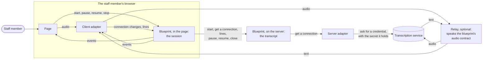
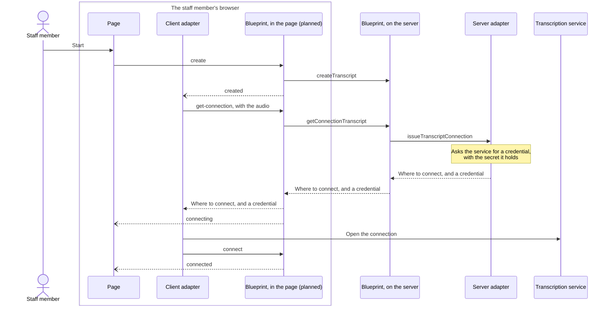
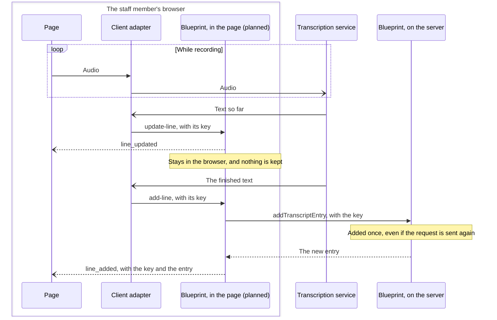
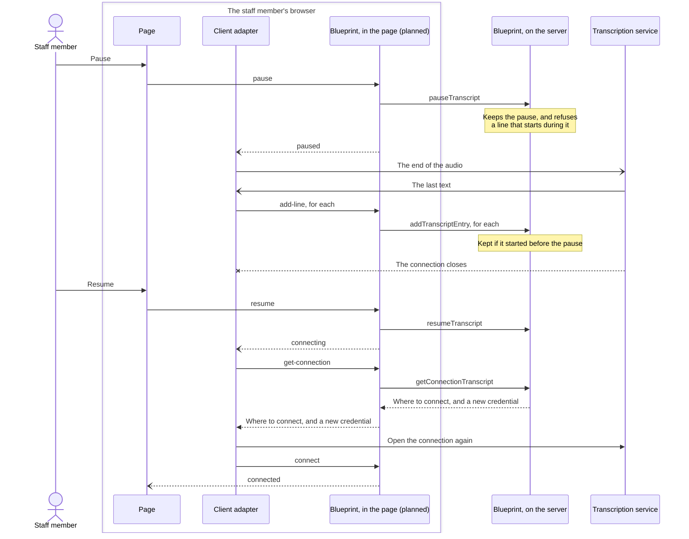
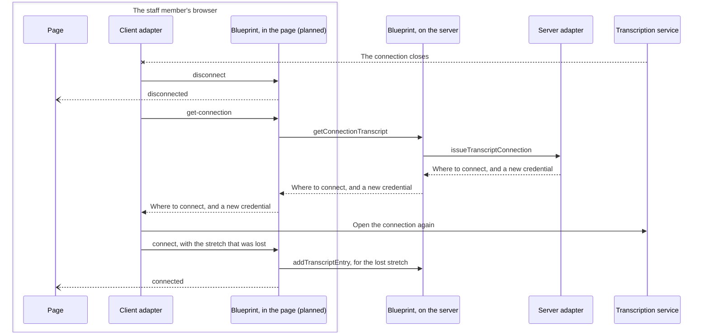
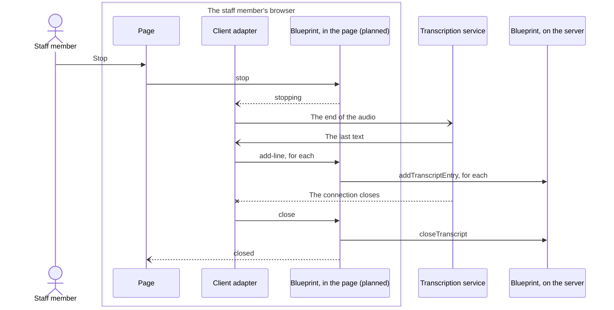

# Communication Domain

> **Status:** Transcripts are built: the transcript, its lifecycle, its
> timeline, the profiles it is started under, closing an abandoned one, and
> asking how to stream to a transcription service, through a server adapter a
> state runs, with the audio contract a relay speaks, in the framework's
> `communication` domain (`blueprint-core/base-contracts/domains/communication/`).
> The session that keeps track of the software's connection is planned. Notices have minimal
> contracts, for document request notices; their full lifecycle is TBD.

See [Domain Design Overview](domain-design.md) for context, [AI Services](../cross-cutting/ai-services.md)
for how transcripts fit with suggestions and fact extraction, and [Contract-Driven Architecture](../contract-driven-architecture.md) for the
contract approach.

## Overview

The Communication domain covers what passes between the agency and the people
it serves: the notices sent to clients, and the written record of conversations
with them.

Notices — approvals, denials, requests for information, document requests, and
other official correspondence — can originate from any domain; Communication
reacts to domain events and handles delivery. A contract set declares its
notices itself.

A transcript is the written record of one conversation: who said what, and
when, including the stretches that were off the record and the stretches that
were lost. It is not tied to audio — a chat or a text-message exchange produces
one too — and everything that comes after it, from fact extraction to the lines
a suggestion cites as evidence, needs only the record, not how it was
captured. In the safety net contracts, the first use is an assistant following
an eligibility interview, working from its transcript. The blueprint
holds the record and the rules for keeping it; turning speech into text is done
by a transcription service the staff member's transcription software talks to directly.
Transcripts are provided by the framework, and a contract set includes them by
listing the `transcripts` capability ([Decision 1](#decision-1-a-framework-domain-of-its-own)),
without taking anything else the framework adds to the domain.

## What happens during a transcribed conversation

1. A staff member starts a transcript for the conversation — an interview, say —
   under a profile: the transcription service and languages the state chose for
   that kind of conversation. The software begins sending the audio to that
   service.
2. As each sentence is finished, the software adds it to the transcript, with
   when it was said and who said it.
3. If the other person asks to go off the record, the staff member pauses the
   transcript. Nothing said while paused is kept. When they resume, recording
   continues.
4. If transcription drops out — a lost connection, a service failure — the
   software records the stretch that was lost once transcription works again.
5. Anyone following along, such as the staff member's own screen, sees each
   change as it happens.
6. When the conversation ends, the staff member closes the transcript. Nothing more is
   added after that.

## How the parts work together

This is where transcription is headed. Some of it is built: the transcript,
asking how to stream, the server adapter, and routing, which decides where
each part runs. The session, which keeps track of the software's connection,
is planned; the diagrams mark it so.

### Where each part runs: routing

The blueprint runs in two places at once, and routing is what makes that
possible. Its contracts are the same everywhere; routing is per-environment
configuration that says which domain, API or operation is answered where, so
no contract has to say where it runs.

- **The session runs in the page.** It's designed to: it keeps track of one
  browser tab's connection and doesn't outlive the tab, and lines in progress
  have to stay in the browser
  ([Decision 3](#decision-3-audio-never-passes-through-the-blueprint)).
- **Everything that's kept runs on the server:** the transcript, its events,
  and asking how to stream, which reaches the server adapter.
- **One routing entry does it:** route the communication domain to the server,
  except the session's API, which stays in the page. The session's actions
  call the transcript's operations by their ids, so routing carries those calls
  to the server too.
- **A demo with no backend** routes nothing: the mock serves everything in the
  page. It answers the server adapter's operation with a routing `handler` in
  the page, or a test answers it with an HTTP stub.

The [mock guide's routing section](../../guides/mock-server.md#routing-to-a-real-service)
has the configuration. The diagrams below show the end state, with the
blueprint in both places.

### The parts

| Part | What it does |
|---|---|
| Page | The staff member's screen. It captures audio and calls only the blueprint, except to hand audio to the client adapter. |
| Client adapter | Code in the page that speaks one transcription service's protocol. The only part of the page that knows which service it is. It tells the session about its connection and the lines it hears ([Decision 17](#decision-17-everything-the-client-adapter-tells-the-session-goes-in-as-an-action-and-each-action-sends-an-event-out)). |
| Blueprint, in the page: the session | Keeps track of the connection, shows lines in progress, and calls the server for everything that's kept. Kept in the page by routing. Planned. |
| Blueprint, on the server: the transcript | Keeps the transcript and its rules, and sends every change as an event. |
| Server adapter | A state's service beside the blueprint. It holds the transcription service's secret and issues a credential that lasts minutes ([Decision 12](#decision-12-the-software-asks-the-server-how-to-stream-in-one-shape-for-every-service)). |
| Transcription service | Turns speech into text: Amazon Transcribe, Deepgram, a model the state runs. |
| Relay | Only for a service a browser can't reach, such as Google Cloud Speech-to-Text, which takes only gRPC, or a model the state runs itself. A server the state runs, between the client adapter and the service: it speaks the blueprint's audio contract, `communication-transcripts-audio-asyncapi.yaml`, to the client and the service's own protocol to the service. Without a relay, the client speaks the service's own protocol ([Decisions 13](#decision-13-a-service-with-no-browser-path-sits-behind-a-relay-that-speaks-the-blueprints-audio-contract) and [14](#decision-14-the-audio-contract-takes-the-services-common-pattern-and-the-standard-result-names)). |

The relay is only for a service a browser can't reach; otherwise the client
adapter connects to the service directly. With a relay, the client adapter
connects to the relay instead, using
a client adapter for the audio contract that works with any relay; the server
adapter answers `get-connection` with the relay's address and a token it signs
itself; and in the diagrams below, the relay stands where the transcription
service is. Nothing else changes.

Audio goes from the page straight to the service, or its relay, and never
through the blueprint. Lines in progress stay in the browser; only finished lines reach the
server. The secret never reaches the page. Every diagram below starts with the
staff member signed in; how they sign in is part of the security model in
[Identity & Access](../cross-cutting/identity-access.md).

In the diagrams, a solid arrow is a request and a dotted one its answer. A
dotted, open-headed arrow is an event, sent to whoever follows along; a solid,
open-headed one is a frame on an open connection. Neither is answered. An
arrow ending in an x is a connection closing.

Arrows are labeled with what the contracts name them
([Decision 17](#decision-17-everything-the-client-adapter-tells-the-session-goes-in-as-an-action-and-each-action-sends-an-event-out)):
a request to the session with its action, a request to the server with its
operation, and an event with its name. The session's events are
`communication.transcription_session.<event>`, written here by their last
part; the transcript's are written in full. Arrows to and from the service,
and the audio, describe what passes, since those aren't the blueprint's.

### Starting and connecting

### Each line spoken

### Going off the record

No audio leaves the page while the transcript is paused ([Decision 16](#decision-16-going-off-the-record-stops-the-audio)).

### When the connection drops

If it can't connect again, the client adapter calls `fail`, and the session is
`failed`; the transcript stays open.

### Stopping

## Entity model

### Notice

An official communication sent to a client (full schema TBD).

### Transcript

The record of one conversation.

- **What it records** — the conversation it belongs to, such as an interview,
  and what kind of thing that is. A transcript is reused across conversation
  types — in a benefits program, interviews, calls on an existing case, fair
  hearings — so it names its
  subject rather than belonging to one.
- **What produced it** — the profile it was started under, which names the
  transcription service; the software that wrote it; and the service's model.
  Two transcripts made a month apart by the same service can differ because
  the service changed its model, and anyone judging a transcript's accuracy
  needs to know which produced it. A typed conversation is started under a
  profile with no service.
- **When it started and closed** — by the software's clock, the same clock
  every time on its entries uses, so every comparison is between times from one
  clock.
- **When it was last heard from** — when its last line or gap ended, by the
  software's clock. A transcript closed for being idle closes at that time.
- **Status** — recording, paused or closed. See the lifecycle below.

A transcript is refused when its profile does not exist, or when the profile
names a service and the transcript does not say which model.

### Profile

A state's choice of how to transcribe a kind of conversation.

- **The transcription service**, or none, for a chat or typed notes.
- **The languages** the conversation may be in. One fixes the language; several
  let the service tell which is being spoken, for an interview that moves
  between them. With none, the service detects the language itself, which not
  every service can do.

A deployment's configuration seeds the profiles. After that, they are added and
changed through the API, and never deleted, so every transcript's profile still
exists. Each change is recorded with what it changed from, so what a profile said
when any transcript started can be looked up. Settings that depend on the
software's own equipment — the audio format, which channel carries which
speaker — are the software's to choose, not the profile's.

### Entry

One period of the conversation, in a timeline under the transcript. Every entry
has a start and an end, so one ordering and one set of rules cover every kind.

- **Kind** — a line, a gap or a pause. The three mean different things to
  someone relying on the record: a line is something said or typed; a gap is a
  stretch lost by accident, where the record is incomplete; a pause is a
  stretch off the record by choice, where nothing is missing.
- **Started and ended** — when the period began and ended. A pause still going
  on has no end yet.
- **Text** (lines) — what was said or typed.
- **Speaker** (lines) — who said it, as a role. The contract set names its roles,
  so a benefits program can say worker and applicant.
- **The service's speaker label** (lines) — with one microphone in a room, a
  transcription service labels speakers "speaker 0" and "speaker 1", and
  something has to map those to people. Keeping the service's own label lets a
  wrong mapping be corrected later.
- **Confidence** (spoken lines) — how sure the service was, for anyone weighing a
  line as evidence.
- **Language** (lines) — the language the line was transcribed in, as the service
  reported it. People move between languages within a conversation, so each line
  says its own rather than the speaker or the transcript; anything that
  translates a line, or cites one, needs to know.
- **Cause** (gaps) — why nothing was captured, as far as the software knows:
  the connection, the service, the software, or unknown. It shows how
  reliable a transcript is.

## Transcript lifecycle

| State | Description | SLA clock |
|---|---|---|
| Recording | The conversation is on the record; lines are accepted. | none |
| Paused | The conversation is off the record, usually because the other person asked. Nothing said now is kept. | none |
| Closed | The conversation has ended. Terminal. | none |

A transcript starts recording. Pausing moves it to paused and begins a pause in
its timeline; resuming returns it to recording and ends that pause. Closing, from
either state, ends it — and ends a pause still open.

What a transcript accepts follows from the lifecycle:

| The software | The transcript |
|---|---|
| Adds a line said while recording | Keeps it — even if it arrives after a pause began |
| Adds a line said while paused, or after closing | Refuses it |
| Adds a line that ends before it starts | Refuses it |
| Records a lost stretch that overlaps a pause | Refuses it: the pause already accounts for that time |
| Sends the same line again on a retry | Keeps one |
| Sends lines out of order | Lists them in the order they were said |
| Changes an entry once written | Refuses it. Only the lifecycle ends a pause |
| Never closes — the browser closed, the machine crashed | Closes it, when its profile sets an idle timeout, between one and two of those after the software was last heard from — at the time it was last heard from |

A refusal names the rule that did not hold.

## Domain events

| Event | Why it's needed | Trigger | Primary consumers |
|---|---|---|---|
| `communication.transcript.created` | A conversation began being recorded | Starting a transcript | The staff member's screen; anything that will read the transcript |
| `communication.transcript.paused` | The conversation went off the record | Pausing | The staff member's screen; audit |
| `communication.transcript.resumed` | It is back on the record | Resuming | The staff member's screen; audit |
| `communication.transcript.closed` | The record is complete, so work that needs the whole conversation can begin | Closing | Fact extraction and suggestions |
| `communication.transcript_entry.created` | A line, a lost stretch or a pause was added | Adding an entry, or pausing | The staff member's screen; anything reading the conversation live |
| `communication.transcript_entry.updated` | A pause ended | Resuming, or closing while paused | The staff member's screen |
| `communication.transcript.updated` / `.deleted` | What a transcript records was corrected, or it was removed | Updating or deleting it | Audit |
| `communication.transcription_profile.created` | A profile was added through the API | Adding a profile | Audit |
| `communication.transcription_profile.updated` | A profile changed; records each change with what it changed from | Changing a profile | Audit; anyone asking what a transcript was started under |

### How notices are triggered

Communication sends notices by subscribing to domain events rather than receiving direct API calls. The producing domain emits an event when its own state changes; Communication reacts independently. No calling domain has a compile-time or runtime dependency on the Communication API contract.

This is consistent with the decision rule in [`docs/architecture/inter-domain-communication.md`](../inter-domain-communication.md): use a command only when the caller needs a result to continue its operation. Sending a notice is a fire-and-observe side effect, not a blocking dependency.

#### Inbound: `intake.verification.created` (document-type)

Communication subscribes to this event filtered by `verificationType === 'document'`. When a document-type Verification is created — either at application submission (e.g., residency) or as a fallback after an inconclusive electronic check — Communication sends a document request notice to the applicant.

#### Outbound: `communication.notice.sent`

Emitted after a notice is sent.

| Field | Type | Notes |
|-------|------|-------|
| `noticeId` | uuid | The notice record ID |
| `type` | enum | Template identifier — see `NoticeSentEvent` schema |
| `sentAt` | date-time | When the notice was sent |
| `metadata` | object | Domain-keyed correlation context (opaque) |

`metadata.intake.verificationId` carries the Intake Verification ID so Intake can correlate the notice back without a separate lookup.

**Intake reaction:** Intake subscribes to `communication.notice.sent` and appends `{ noticeId, type, sentAt }` to the relevant Verification's `documentRequests[]`.

## Contract artifacts

### Transcripts

All in `blueprint-core/base-contracts/domains/communication/`.

| Artifact | File |
|---|---|
| API — transcripts, their entries, and profiles | `communication-transcripts-openapi.yaml` |
| Lifecycle and the rules for entries | `communication-transcripts-state-machine.yaml` |
| Events | Generated by resolve beside the API, as `communication-transcripts-events-asyncapi.yaml`, from the API and the state machine's `emits:` |
| Transcription services | `communication-transcripts-registry-transcription-services.yaml` |
| The adapter a state runs to issue a service's credential (Decision 12) | `communication-transcripts-adapter-openapi.yaml` |
| The audio a relay takes (Decisions 13 and 14) | `communication-transcripts-audio-asyncapi.yaml` |
| Shapes the adapter, the audio contract and the transcripts API share | `communication-transcripts-schema.yaml` |
| Profiles a deployment starts with | `communication-transcripts-config.yaml`, validated by `communication-transcripts-config-schema.yaml` |
| Sample transcripts | `communication-transcripts-mock-data.yaml` |

### Notices

In the safety net contract set, `safety-net-contracts/src/domains/communication/`.

| Artifact | Status | Notes |
|----------|--------|-------|
| OpenAPI spec | Alpha | `communication-openapi.yaml` — shell spec. No REST paths yet. `communication.notice.sent` is a placeholder in `communication-asyncapi.yaml` until the notice resource and its state machine exist. |
| Event schemas | Defined | `communication-asyncapi.yaml` — `NoticeSentEvent` |
| State machine YAML | TBD | Notice lifecycle |
| Rules YAML | TBD | Routing rules, retry policies |
| Metrics YAML | TBD | Delivery success rates, time-to-send |

## Key design decisions

| # | Decision | Summary |
|---|---|---|
| 1 | [A framework domain of its own](#decision-1-a-framework-domain-of-its-own) | Transcription is a capability the framework provides and a contract set opts into |
| 2 | [Live transcription is not a data exchange call](#decision-2-live-transcription-is-not-a-data-exchange-call) | Its own resource; recordings transcribed after the fact can still use data exchange |
| 3 | [Audio never passes through the blueprint](#decision-3-audio-never-passes-through-the-blueprint) | The software streams audio to the service; the blueprint receives finished lines |
| 4 | [One timeline of entries](#decision-4-one-timeline-of-entries) | Lines, lost stretches and pauses in one ordered list |
| 5 | [An entry is judged by when it started](#decision-5-an-entry-is-judged-by-when-it-started) | Not by when it arrives |
| 6 | [One clock: the software's](#decision-6-one-clock-the-softwares) | Every time on a transcript comes from the software |
| 7 | [Entries do not change](#decision-7-entries-do-not-change) | Only the lifecycle ends a pause |
| 8 | [A retry is recognized by a key](#decision-8-a-retry-is-recognized-by-a-key) | The software sends the same key when it retries |
| 9 | [A dropped connection is a gap, not an event](#decision-9-a-dropped-connection-is-a-gap-not-an-event) | The record shows what was lost, whatever caused it |
| 10 | [A transcript names its profile; the profile's history is the record](#decision-10-a-transcript-names-its-profile-the-profiles-history-is-the-record) | Profiles change through the API, and their change events say what each said when |
| 11 | [Event-driven triggers — not RPC](#decision-11-event-driven-triggers--not-rpc) | Notices are sent in reaction to other domains' events |
| 12 | [The software asks the server how to stream, in one shape for every service](#decision-12-the-software-asks-the-server-how-to-stream-in-one-shape-for-every-service) | Where to connect, a short-lived credential and the settings to send, named as OAuth names a token response |
| 13 | [A service with no browser path sits behind a relay that speaks the blueprint's audio contract](#decision-13-a-service-with-no-browser-path-sits-behind-a-relay-that-speaks-the-blueprints-audio-contract) | Google, a self-hosted model, or any service a state fronts itself |
| 14 | [The audio contract takes the services' common pattern and the standard result names](#decision-14-the-audio-contract-takes-the-services-common-pattern-and-the-standard-result-names) | Binary audio, start/end lifecycle, W3C and Google result names; a signed token in the subprotocol |
| 15 | [The session's states follow WebRTC's, named to match its actions](#decision-15-the-sessions-states-follow-webrtcs-named-to-match-its-actions) | `created`, `connecting`, `connected`, `disconnected`, `paused`, `stopping`, `closed` and `failed`; each action's state and event are the same word |
| 16 | [Going off the record stops the audio](#decision-16-going-off-the-record-stops-the-audio) | Pausing disconnects from the service, and resuming connects again |
| 17 | [Everything the client adapter tells the session goes in as an action, and each action sends an event out](#decision-17-everything-the-client-adapter-tells-the-session-goes-in-as-an-action-and-each-action-sends-an-event-out) | The client adapter talks only to the session; whoever follows along listens to its events |
| 18 | [A line in progress is tied to its finished line by the client's key](#decision-18-a-line-in-progress-is-tied-to-its-finished-line-by-the-clients-key) | The entry is created once, when the line is finished, with an id from the server |

### Decision 1: A framework domain of its own

**Status:** Decided: C

**What's being decided:** A transcript has nothing specific to one program or
one kind of conversation in it, so where it is defined decides who can use it.

**Considerations:**
- In a benefits program, interviews, calls on an existing case and fair
  hearings all produce conversations worth a record, across domains and across
  contract sets.
- Platform holds infrastructure every domain plugs into — the event log,
  registries. A transcript is a capability some domains use, with its own
  records, lifecycle and rules, the way scheduling and document management are.
- A contract set that never transcribes anything should carry none of it.
- A transcript is the record of a conversation, one kind of communication;
  notices and messages are others. A set that has a `communication` domain of
  its own adds to the framework's rather than conflicting with it, since
  documents of one domain combine.

**Options:**
- **(A)** In the domain of its first use — intake, in the safety net contracts. Another domain could not use it, and
  since intake belongs to one contract set, neither could another set.
- **(B)** In the framework's platform domain. Every contract set would get it,
  needed or not.
- **(C) ✓** In a `communication` domain the framework provides, as the
  `transcripts` capability a contract set includes by listing it. See
  [Platform](../cross-cutting/platform.md#decision-3-the-platform-is-infrastructure-only)
  for why a set opts into a capability rather than a whole domain.

### Decision 2: Live transcription is not a data exchange call

**Status:** Decided: B

**What's being decided:** Data exchange already models calls to outside
services, so whether a live transcript is one of those calls decides whether it
gets a resource and lifecycle of its own.

**Considerations:**
- A data exchange call is a request and one answer: the blueprint submits it,
  an adapter performs it, one result comes back.
- A live transcript is started by a staff member, written by their transcription software,
  and grows line by line for an hour, with pauses and lost stretches the call
  lifecycle has no place for.
- Transcribing a recording after the fact — an uploaded call or hearing — is a
  request and one answer.

**Options:**
- **(A)** A data exchange call left open for the whole conversation, with a
  lifecycle unlike any other service type's.
- **(B) ✓** A resource of its own. A recording transcribed after the fact can
  still be a data exchange call whose result fills a transcript, so live and
  after-the-fact transcription end in the same record by two routes.

### Decision 3: Audio never passes through the blueprint

**Status:** Decided: B

**What's being decided:** Turning speech into text happens at a transcription
service, so whether the audio travels through the blueprint on its way there
decides what the blueprint has to understand.

**Considerations:**
- Services design for the browser connecting directly: Amazon Transcribe
  documents streaming from a browser with temporary credentials, and ElevenLabs
  issues single-use tokens so a browser can connect to its service.
- Relaying audio adds delay and cost, and would put each service's own protocol
  inside a vendor-neutral system.
- What the people relying on the record need is the record, not the audio.

**Options:**
- **(A)** The software sends audio to the blueprint, which relays it to the
  service and writes the lines itself.
- **(B) ✓** The software streams audio straight to the service and adds each
  finished line to the transcript. A state that wants audio kept off staff
  machines runs a service that implements the transcript contract and
  transcribes on its side.

**Decision:** Only finished lines reach the blueprint's server. Lines still
being revised stay in the page: the staff member's screen gets them through the
session, which runs there
([Decision 17](#decision-17-everything-the-client-adapter-tells-the-session-goes-in-as-an-action-and-each-action-sends-an-event-out)).
Only finished lines, because:

- A line in progress is revised, often several times a second, and its text is
  the least reliable there is. Keeping it would fill the record with words the
  service later corrected.
- Some lines never finish: the connection drops, the service drops a fragment,
  the conversation goes off the record mid-sentence. Kept, they'd be text
  nobody confirmed, left for something to clean up.
- Whatever reads the transcript, such as analysis and the suggestions that cite
  lines, should see only what was finally heard, without waiting for or
  filtering out drafts.
- Entries don't change ([Decision 7](#decision-7-entries-do-not-change)), and a
  stored, checked write for every revision would cost far more than one per
  sentence.

How a line in progress is tied to the finished line it becomes is
[Decision 18](#decision-18-a-line-in-progress-is-tied-to-its-finished-line-by-the-clients-key).

### Decision 4: One timeline of entries

**Status:** Decided: B

**What's being decided:** A transcript holds lines, stretches that were lost and
stretches that were off the record, so how they are stored decides how anyone
reads the whole conversation.

**Considerations:**
- A reader — a staff member, a reviewer, fact extraction — needs the conversation in
  order, including where it was off the record or lost.
- Caption formats and contact-center transcripts carry non-speech segments,
  such as silence, inline with the speech.
- Which stretches were off the record has to be checked when a line arrives.

**Options:**
- **(A)** Separate lists of lines, lost stretches and pauses, which every reader
  merges by time.
- **(B) ✓** One timeline, each entry a period with its kind. A pause is written
  when the transcript pauses and given its end when it resumes, so the timeline
  shows it while it is happening and is the one record of past pauses.

### Decision 5: An entry is judged by when it started

**Status:** Decided: B

**What's being decided:** A service finishes a line a second or two after it is
said, so a line said just before a pause can arrive just after it, and what the
rule judges decides whether that line is kept.

**Considerations:**
- The software is already trusted for when every line was said.
- A line can begin on the record and run past the moment the staff member paused.
- The point of pausing is that nothing said off the record is kept, even by
  faulty software.

**Options:**
- **(A)** By when it arrives. Simpler, but drops real speech from any
  software that does not send its pending lines before pausing.
- **(B) ✓** By when it started: kept if it started while recording. A few words
  said just after the pause may be kept with the sentence they finish.
- **(C)** By its whole period: refused if any part overlaps a pause. Nothing said
  after the pause is kept, but neither is the sentence it ended.

### Decision 6: One clock: the software's

**Status:** Decided: B

**What's being decided:** Lines carry the software's times while the server
has a clock of its own, so which clock marks the start, pauses and close decides
whether a rule ever compares two clocks.

**Considerations:**
- Two computers' clocks differ by seconds. A rule comparing a line's time with a
  pause the server timed would keep or drop lines by that difference.
- Software that misreports when it paused could equally misreport when a
  line was said, so trusting it for both adds no new trust.

**Options:**
- **(A)** The server times the start, pauses and close; the software times
  lines. Two clocks, compared.
- **(B) ✓** The software times everything. The server keeps its own record of
  when it received things, for auditing.
- **(C)** Judge by when things arrive, with a few seconds' grace after a pause.
  One clock, but faulty software gets a few seconds of off-the-record
  speech kept.

### Decision 7: Entries do not change

**Status:** Decided: B

**What's being decided:** Whether an entry is accepted depends on the pauses
already in the timeline, so whether entries can be edited decides whether the
record can be rewritten after the fact.

**Considerations:**
- Editing a past pause would change which lines should have been kept.
- A pause has to be given its end when the transcript resumes.

**Options:**
- **(A)** Entries editable by whoever can add them.
- **(B) ✓** Nothing about an entry changes but a pause's end, written only by
  resuming or closing. The rule allowing it names the system as the only actor.
- **(C)** A pause written once, complete, on resume. No edits at all, but the
  timeline would not show a pause while it is happening.

**Known gap:** a contract set that renames its roles must keep one for the
system, or validation refuses the transcript's lifecycle.

### Decision 8: A retry is recognized by a key

**Status:** Decided: B

**What's being decided:** Software whose connection drops before it hears
back sends a line again, so how a repeat is recognized decides whether the
transcript gets the line twice.

**Considerations:**
- Payment and cloud APIs recognize retries by a key the client sends with each
  request, the same on every retry; an internet standard for it is in draft.
- Every other record in the blueprint gets its identifier from the server.
- Two people can start speaking at the same instant, so a line's start time
  does not identify it.

**Options:**
- **(A)** The software chooses each entry's identifier.
- **(B) ✓** The software sends a key with each line it adds, and the same key
  on a retry; a repeat gets the first answer back.
- **(C)** A line's start time and speaker together.

### Decision 9: A dropped connection is a gap, not an event

**Status:** Decided: B

**What's being decided:** Whether a dropped connection loses anything depends on
the software — one that buffers audio and sends the backlog loses nothing —
so what the record notes decides what a reader can rely on.

**Considerations:**
- What matters to anyone relying on the transcript is whether it is complete.
- The software learns where a lost stretch ends only once transcription works
  again.

**Options:**
- **(A)** Record each connection change.
- **(B) ✓** Record the outcome: a lost stretch, with both times, once
  transcription comes back or the transcript closes, whatever caused it. A
  "reconnecting" notice on the staff member's screen comes from the software.

### Decision 10: A transcript names its profile; the profile's history is the record

**Status:** Decided: D

**What's being decided:** A transcript has to say what produced it for as long
as it is kept, while the profiles it is started under change — a state moves a
profile to another service, or adds a language.

**Considerations:**
- An old transcript pointing at a profile that has since changed must not appear
  to have been produced by the profile's current service.
- A configuration file changes by deploy, which records nothing a transcript
  can be tied to; a change made through the API is recorded, with what it
  changed from.
- Software should not have to send what the server already knows.

**Options:**
- **(A)** The software sends the service on every transcript, and profiles only
  guide it. Duplicated, and nothing records which profile a transcript ran under.
- **(B)** The server copies the profile's service onto each transcript. Survives
  any later change, but records one setting rather than the profile.
- **(C)** Versioned profiles, each version never changed. A complete record, but
  only while nobody edits a published version — which nothing could prevent —
  and every old version is kept forever.
- **(D) ✓** Profiles are managed through the API and never deleted. A
  transcript names only its profile; the profile's change events say what it
  said at any moment. Finding what a past transcript ran under is a lookup in
  those events — cheap for one transcript, though not a filter across many. If
  reporting by service is needed, the service can be copied onto transcripts
  then (B), without breaking anything.

### Decision 11: Event-driven triggers — not RPC

**Status:** Decided

**What's being decided:** Whether other domains trigger notices via direct API calls to Communication or via domain events.

**Decision:** Domain events. The calling domain has no dependency on Communication's API. Adding a new notice type requires no change to the producing domain — only a new subscription in Communication. This is consistent with the event-driven pattern in `docs/architecture/inter-domain-communication.md`.

### Decision 12: The software asks the server how to stream, in one shape for every service

**Status:** Decided: C

**What's being decided:** The staff member's software streams audio straight to
the transcription service ([Decision 3](#decision-3-audio-never-passes-through-the-blueprint)),
which takes a credential the software must not hold for long; so what the
server hands the software decides which services a deployment can use without
changing the transcript contract.

**Background:** How each service lets a browser stream to it, from its own
documentation, November 2026:

| Service | What the server gets | How the browser presents it | How long it lasts |
|---|---|---|---|
| [Amazon Transcribe](https://docs.aws.amazon.com/transcribe/latest/dg/streaming-setting-up.html) | A presigned WebSocket URL, with the language and audio format signed into it | The URL is the credential | At most 5 minutes to connect |
| [Google Cloud Speech-to-Text](https://docs.cloud.google.com/speech-to-text/docs/streaming-recognize) | Nothing: streaming is gRPC only, which a browser cannot open | Through a relay ([Decision 13](#decision-13-a-service-with-no-browser-path-sits-behind-a-relay-that-speaks-the-blueprints-audio-contract)) | — |
| [Google Gemini Live](https://aistudio.google.com/docs/live-api/ephemeral-tokens) | An ephemeral token | `access_token` query parameter | 1 minute to connect, 30 to use |
| [Azure AI Speech](https://learn.microsoft.com/en-us/azure/ai-services/speech-service/rest-speech-to-text-short#authentication) | A token, and the region it works in | An argument to Azure's SDK, the only browser client | 10 minutes, renewed during a session |
| [OpenAI Realtime](https://developers.openai.com/api/reference/resources/realtime/subresources/client_secrets/methods/create) | A client secret | A bearer header (WebRTC) or a WebSocket subprotocol | Up to 2 hours, reusable |
| [ElevenLabs Scribe](https://elevenlabs.io/docs/api-reference/tokens/create) | A single-use token | `token` query parameter | 15 minutes, consumed on use |
| [Deepgram](https://developers.deepgram.com/reference/auth/tokens/grant) | `access_token` and `expires_in` | A WebSocket subprotocol | 30 seconds to an hour |
| [AssemblyAI](https://www.assemblyai.com/docs/streaming/api-spec/generate-streaming-token.md) | A token | `token` query parameter | At most 10 minutes to connect |
| [Speechmatics](https://docs.speechmatics.com/get-started/authentication) | A temporary key | `jwt` query parameter | 1 minute to a day |
| [Gladia](https://docs.gladia.io/chapters/live-stt/getting-started) | A session URL with its token | The URL is the credential | Resumable at the same URL |

**Considerations:**
- Every service fits four things: where to connect, a credential unless the
  URL carries one, how long it lasts, and settings the software sends when it
  connects. Which settings are fixed when the credential is issued and which
  are sent on connecting varies by service, so the settings the server chose
  travel with the answer.
- Each service frames audio and results its own way, so the software needs a
  small adapter per service whatever the server answers. The adapter knows
  where its service wants the credential; the answer doesn't need to say.
- OAuth 2.0's token response ([RFC 6749 §5.1](https://www.rfc-editor.org/rfc/rfc6749#section-5.1))
  names a credential and its lifetime, and Deepgram returns exactly those
  names. Nothing standard names where to connect or the settings to send.
- A credential lifetime relative to now (`expires_in`) doesn't depend on the
  software's clock agreeing with the server's.

**Options:**
- **(A)** The software holds the service's key. Anyone with the page has it.
- **(B)** An operation per service, answering in that service's own shape. A
  new service is a contract change.
- **(C) ✓** One operation on the transcript, answering in one shape for every
  service: the service, the protocol (`websocket` or `webrtc`), the URL, the
  credential as `accessToken` and `tokenType` with `expiresIn`,
  `connectionParameters`, and — for a relay — the `subprotocol` the connection
  speaks ([Decision 14](#decision-14-the-audio-contract-takes-the-services-common-pattern-and-the-standard-result-names)). The request says the audio format the software will
  send, which a service may sign into the credential. Behind the operation, a
  server adapter holds the service's secret and issues the credential.

**Decision:** OAuth's names, with its meaning and in the blueprint's camelCase.
The operation is the transcript's `get-connection` action,
`POST /transcripts/{transcriptId}/get-connection`: an action, so its guards say who may
ask and that the transcript is recording, as `pause`'s do. Its steps call the
server adapter, and it answers with the connection, not the transcript, by
naming its response's schema and payload together (see the
[DSL](../cross-cutting/behavioral-contract-dsl.md)). The answer is `200`: nothing is
stored, and each call issues a fresh credential.

The server adapter, `communication-transcripts-adapter-openapi.yaml` beside the
transcripts API, has one operation, `issueTranscriptConnection`
(`POST /issue-connection`). It takes what any service needs to issue a credential:

- the service and its languages, from the transcript's profile, and the model,
  from the transcript. Each adapter maps the languages to what its service
  takes — one, a list, or none to detect — and answers `422` naming the
  problem when it can't, rather than start a transcript in the wrong language;
- the audio the software will send, from the request: its encoding, named as
  Google Cloud Speech-to-Text names them, which fix the bit depth; its sample
  rate; and how many channels it has. More than one channel means the service tells speakers apart by channel, one that it does
  by voice — a line must name its speaker, and Amazon Transcribe signs which
  into its URL. The software's adapter, which is specific to its service,
  captures audio in a format that service accepts; the request reports it;
- the protocols the software speaks, of which the adapter picks one, so a
  software adapter is never handed a protocol it doesn't know;
- `metadata`, echoed back, as every adapter does.

Settings that don't change from one call to the next — a region, a custom
vocabulary, redaction — are the adapter's own configuration. Each of these
grows without breaking: a new service is a registry entry and an adapter, a
new setting an optional field. A credential that isn't a token — Amazon's
temporary keys for its SDK, through a Cognito identity pool — can be added the
way protocols are, offered only to software that says it handles one; a
presigned URL covers Amazon Transcribe without it, giving the software one
stream rather than keys. The contract is versioned as every API is
(`docs/conventions/http.yaml`), not in its messages.

Calling again is how the software renews a credential, whenever a service
needs one: Azure's lasts ten minutes and is replaced during a session, so its
software adapter asks again before `expiresIn` runs out. Where the settings go
is the software adapter's to know, as where the credential goes is: most
services take `connectionParameters` on connecting, and Speechmatics in its
first message.

### Decision 13: A service with no browser path sits behind a relay that speaks the blueprint's audio contract

**Status:** Decided: C

**What's being decided:** Some services can't be reached from a browser at
all — Google Cloud Speech-to-Text accepts only gRPC, and a model a state runs
itself has no browser credentials — so what stands in for the service
decides whether a deployment can use them.

**Considerations:**
- Something outside the browser has to receive the audio and pass it on. The
  mock running in a page can't either: it is code in the same browser.
- A relay is the state's service, on the service's side. The software streams
  to it as it would to any service, so audio still never passes through the
  blueprint ([Decision 3](#decision-3-audio-never-passes-through-the-blueprint)).
- Self-hosted models — Whisper, NVIDIA Riva — are a real option for a state
  that doesn't want interview audio sent to a vendor, and have no browser
  path. A relay also lets a state keep audio inside its own boundary, or change
  the service behind it without changing the software.

**Options:**
- **(A)** Support only services a browser can reach. Google Cloud and
  self-hosted models are out.
- **(B)** A relay that copies an existing service's protocol, ElevenLabs' say,
  so that service's software adapter works unchanged. The blueprint's design
  then depends on a vendor's format.
- **(C) ✓** A relay that speaks an audio contract the blueprint defines, in
  AsyncAPI: one software adapter works with any relay, for any service behind
  it. The operation in [Decision 12](#decision-12-the-software-asks-the-server-how-to-stream-in-one-shape-for-every-service)
  answers with the relay's URL and a credential the relay accepts.

**Decision:** Choosing a service behind a relay means running the relay: a
deployment that uses one, including a demo in a page, points the software at
wherever the state hosts it.

### Decision 14: The audio contract takes the services' common pattern and the standard result names

**Status:** Decided: C

**What's being decided:** A relay ([Decision 13](#decision-13-a-service-with-no-browser-path-sits-behind-a-relay-that-speaks-the-blueprints-audio-contract))
receives audio from the software and sends back what the service heard, so
the messages it speaks decide what every relay builds and the one software
adapter that talks to any of them.

**Background:** How streaming services shape the connection, from their own
documentation, November 2026:

| Service | Audio up | Settings | Results down | Ending |
|---|---|---|---|---|
| [Deepgram](https://developers.deepgram.com/reference/speech-to-text/listen-streaming) | Binary frames | Query parameters | `Results`: `is_final`, `speech_final`, `alternatives[]`, words with speaker | `CloseStream` |
| [AssemblyAI](https://www.assemblyai.com/docs/api-reference/streaming-api/streaming-api) | Binary frames | Query parameters | `Turn`: `end_of_turn`, words in ms | `Terminate` → `Termination` |
| [Speechmatics](https://docs.speechmatics.com/rt-api-ref) | Binary frames | `StartRecognition` → `RecognitionStarted` | `AddPartialTranscript`, `AddTranscript` | `EndOfStream` → `EndOfTranscript` |
| [Gladia](https://docs.gladia.io/chapters/live-stt/getting-started) | Binary frames | Set when the session is made | `transcript`: `is_final`, speaker, channel | `stop_recording` → `end_session` |
| [ElevenLabs](https://elevenlabs.io/docs/api-reference/speech-to-text/v-1-speech-to-text-realtime) | Base64 in JSON | Query parameters | `partial_transcript`, `committed_transcript` | — |
| [OpenAI Realtime](https://developers.openai.com/api/docs/guides/realtime-transcription) | Base64 in JSON | `session.update` | `…transcription.delta`, `.completed`; no timing or speakers | — |
| [Amazon Transcribe](https://docs.aws.amazon.com/transcribe/latest/dg/streaming-setting-up.html) | AWS event-stream frames | Signed into the URL | `IsPartial`, `Alternatives[]`, `ChannelId` | An empty audio event |
| [Google Cloud](https://docs.cloud.google.com/speech-to-text/v2/docs/reference/rpc/google.cloud.speech.v2), [NVIDIA Riva](https://github.com/nvidia-riva/common) | gRPC: config first, then audio | First message | `is_final`, `alternatives[{transcript, confidence, words}]`, `channel_tag` | Close the stream |

No standard defines the connection. The W3C [Web Speech API](https://webaudio.github.io/web-speech-api/)
names results in a browser — `isFinal`, `alternatives`, `transcript`,
`confidence` — and is the only standard naming there is; MRCP (RFC 6787) runs
over SIP, not WebSockets.

**Considerations:**
- Most services send audio as raw binary frames, which base64 in JSON makes a
  third larger, and settle on one lifecycle: the software starts, streams,
  and ends, and the service answers its last results before saying it's done.
- A relay mostly translates Google's or a self-hosted model's results, which
  are Google-shaped; result names taken from Google and the Web Speech API map
  from them almost one to one.
- Deepgram's protocol is the most copied — a self-hosted Whisper server,
  WhisperLiveKit, speaks it — and Deepgram publishes it in AsyncAPI.
- Browser code can't send WebSocket pings, so keeping a quiet connection open
  needs a message of its own.

**Options:**
- **(A)** Copy Deepgram's protocol. Settings ride in the URL, the names are
  Deepgram's, and two "final" flags (`is_final`, `speech_final`) mean
  different things.
- **(B)** Copy OpenAI's. Audio is base64, and results carry no timing or
  speakers, which every line needs.
- **(C) ✓** A message set of the blueprint's, in AsyncAPI, built from what the
  services share and the standard names: `start` → `started`; audio as binary
  frames; `keepalive`; `finalize` to flush what's been said; `end` → the last
  results → `ended`; `result` with `isFinal` and
  `alternatives[{transcript, confidence, words}]`, its start and end, channel,
  language and speaker; and `error` with codes after the Web Speech API's.

**Decision:** Three things are the blueprint's own, since no service settles
them: each result has an id, so a final result replaces its earlier versions
— Google's have none; times are whole milliseconds from the start of the
connection — services split between seconds and milliseconds; and speaker
labels are strings — Riva's are numbers, Google's and Gladia's strings.

The connection is a WebSocket, the one way to stream both ways that every
browser has and a state can run simply; WebRTC or WebTransport would be another
server in the AsyncAPI document, offered only to software that names it in
`get-connection`'s protocols. The relay speaks the subprotocol
`blueprint.transcripts.audio.v1` ([RFC 6455](https://www.rfc-editor.org/rfc/rfc6455)'s
way for a WebSocket to say what it speaks), which `get-connection` answers with, so
the software knows to use its relay adapter.

The relay accepts a signed, short-lived JWT ([RFC 7519](https://www.rfc-editor.org/rfc/rfc7519),
following RFC 8725), which it checks itself: the server adapter signs it with a
private key, naming the relay as its audience and expiring within a minute,
and the relay checks the signature, audience and expiry against the public key
the adapter publishes. Every relay can — each is a server, and every server
language has the libraries — without a call per connection, and the relay can
check tokens but never make them; a token that can't be revoked does little
harm in the minute it lasts. An opaque token the relay asks about (RFC 7662)
could be revoked, but costs a call and an endpoint; the staff member's own
sign-in token would tie the relay to one identity provider and to no
transcript. The software sends it in the WebSocket subprotocol header, beside
the subprotocol's name, not in the URL: RFC 6750 says to avoid tokens in URLs,
which are logged. A deployment with no backend of its own still has the relay's,
so the relay's deployment runs the server adapter that signs.

### Decision 15: The session's states follow WebRTC's, named to match its actions

**Status:** Decided: E

**What's being decided:** The session keeps track of the software's
connection to its transcription service, in the page, so its states are what a
page shows the staff member and what decides which of its actions can happen
when. They need names a developer already knows, a state for every situation
the page has to show differently, and names that agree with the session's
actions and events
([Decision 17](#decision-17-everything-the-client-adapter-tells-the-session-goes-in-as-an-action-and-each-action-sends-an-event-out)).

**Considerations:**
- A browser already names the states of a live media connection: W3C WebRTC's
  `RTCPeerConnection.connectionState` is `new`, `connecting`, `connected`,
  `disconnected`, `failed` and `closed`, and its `connectionstatechange` event
  reports the state entered. WebSocket's `readyState` adds `CLOSING`, between
  asking to close and being closed.
- Stopping isn't immediate. The software sends the end of the audio, and the
  service sends its last lines before it closes the connection, so there is a
  stretch where lines still arrive after the staff member pressed Stop.
- A connection that can't be restored has to look different from one that
  ended normally. The transcript is still open, and the staff member can
  start a new session and carry on.
- An action, the state it leads to, and the event it sends should be the same
  word, so a developer who knows one knows the others: `pause` → `paused`.
  Every resource in the blueprint already gets a `created` event when it's
  made, generated by resolve.
- The contracts have to stay vendor-neutral, so a page and its client
  adapters work the same whichever service a state chose. Each vendor's SDK
  names its own events (Azure's `sessionStarted` and `canceled`, the Web Speech
  API's `start` and `end`); a browser standard belongs to none of them.
- The repo's standards say to use XState's and SCXML's terms for state machine
  concepts, such as a final state. They don't name a connection's states.

**Options:**
- **(A)** Names of our own: idle, connecting, live, interrupted, stopping,
  ended.
- **(B)** WebSocket's four states: `CONNECTING`, `OPEN`, `CLOSING`, `CLOSED`.
  They describe one socket, which can't recover once closed, while a session
  spans a connection per reconnect and resume; and they have nothing for not
  started yet, or for giving up. Not every service is reached over a
  WebSocket either.
- **(C)** WebRTC's six states as they are, with no state for stopping: the
  session stays `connected` until the last lines are in, and the page can't
  show that it's finishing.
- **(D)** WebRTC's six states, and `closing` from WebSocket for the stretch
  after Stop. Two names then disagree with what goes with them: `new` with the
  generated `created` event, and `closing` with the `stop` action.
- **(E) ✓** WebRTC's names where they agree with the session's actions —
  `connecting`, `connected`, `disconnected`, `closed`, `failed` — and
  `created` and `stopping` where they don't.

**Decision:** `created` → `connecting` → `connected`; `connected` →
`disconnected` when the connection drops, and back to `connecting` to try
again; `paused` while off the record
([Decision 16](#decision-16-going-off-the-record-stops-the-audio)), and
`connecting` again on resume; `stopping` after Stop, then `closed`. `failed`
when the software gives up reconnecting. `closed` and `failed` are final
states: a staff member who wants to carry on starts a new session under the
same transcript. When to give up reconnecting is the client adapter's to
decide, not the contract's: how many tries and how long depend on the service
and the network, and the contract only needs `fail` for when it does.

### Decision 16: Going off the record stops the audio

**Status:** Decided: B

**What's being decided:** A paused transcript refuses any line that starts
while paused ([Decision 5](#decision-5-an-entry-is-judged-by-when-it-started)),
so nothing said off the record is kept. But the software could still be sending
the audio to the transcription service. Whether "off the record" also means the
service doesn't hear it decides what pausing has to do to the connection.

**Considerations:**
- Someone who asks to go off the record expects not to be heard, not only not
  to be written down. A vendor that receives the audio may keep or log it,
  whatever the blueprint does with the text.
- Services close a connection that goes quiet: Amazon Transcribe after 15
  seconds without audio, Deepgram after 10 unless sent a keepalive. A pause
  can last much longer.
- The contracts have to work the same with every service, so a page and its
  client adapters don't depend on which vendor a state chose. Keeping a quiet
  connection open is done differently by each vendor; disconnecting and
  connecting again is the same for all of them.
- The software already knows how to reconnect: it asks how to stream again
  ([Decision 12](#decision-12-the-software-asks-the-server-how-to-stream-in-one-shape-for-every-service)),
  as it does after a dropped connection.

**Options:**
- **(A)** Stay connected and stop sending audio. No new state, but every
  service needs keeping alive in its own way, and nothing in the record shows
  the audio stopped.
- **(B) ✓** Disconnect when the transcript is paused, and connect again when it
  resumes. The session gets a `paused` state, distinct from `disconnected`
  because nothing tries to reconnect.

**Decision:** No audio leaves the page while the transcript is paused, with any
service, and resuming reuses the reconnect path. Resuming takes as long as
connecting, about a second.

### Decision 17: Everything the client adapter tells the session goes in as an action, and each action sends an event out

**Status:** Decided: B

**What's being decided:** The client adapter tells the session what happens to
its connection and what the service heard: connected, disconnected, a line in
progress, a finished line, done, gave up. Each of these could reach the blueprint as an
action on the session, or only as an event for whoever follows along, since
some, like a line in progress, change nothing that's kept.

**Considerations:**
- A state machine's job is to take actions in, check them against its state,
  change the record, and send events out. An action is the only way into the
  session that its contract defines and its guards check.
- Something sent only as an event would go straight to the event stream,
  outside the session's contract, so nothing would refuse a line that arrives
  after the session failed.
- Whoever follows along, the page or another tab, needs every one of them, so each
  one has to reach them as an event either way.
- One API for every client adapter, whatever its service, keeps the contracts
  vendor-neutral.

**Options:**
- **(A)** What changes state goes in as an action; the rest, such as a line in
  progress, are events the client sends directly.
- **(B) ✓** Everything goes in as an action on the session, and every action emits
  an event. An action that changes nothing kept, such as a line in progress,
  stores nothing and only sends its event.

**Decision:** The page and the client adapter talk only to the session, never
to the transcript; the session's actions call the transcript's operations on
the server. An action is named for what happens. One that changes the
session's state leads to the state of the same word, and sends the event of
that name, as WebRTC's `connectionstatechange` reports the state entered
([Decision 15](#decision-15-the-sessions-states-follow-webrtcs-named-to-match-its-actions)).
One that doesn't change it sends an event named for what happened. Each of the
session's events is `communication.transcription_session.<event>`.

| What it says | Sent by | Action | State | What it calls on the server | Event |
|---|---|---|---|---|---|
| Start | Page | `create` | `created` | `createTranscript` | `created` |
| How do I stream? | Client | `get-connection` | `created`, `disconnected` or `connecting` → `connecting`; while `connected`, no change, to renew the credential | `getConnectionTranscript`, and answers with what it gets | `connecting`, or none when renewing |
| The connection is open | Client | `connect` | `connecting` → `connected` | After a reconnect, `addTranscriptEntry` for the lost stretch ([Decision 9](#decision-9-a-dropped-connection-is-a-gap-not-an-event)) | `connected` |
| The connection dropped | Client | `disconnect` | `connected` → `disconnected` | Nothing | `disconnected` |
| A line in progress | Client | `update-line` | No change, while `connected` or `stopping` | Nothing; the line is only shown | `line_updated` |
| A finished line | Client | `add-line` | No change, while `connected`, `paused` or `stopping` | `addTranscriptEntry`, with the line's key ([Decision 18](#decision-18-a-line-in-progress-is-tied-to-its-finished-line-by-the-clients-key)) | `line_added` |
| Pause | Page | `pause` | `connected` → `paused` | `pauseTranscript` | `paused` |
| Resume | Page | `resume` | `paused` → `connecting` | `resumeTranscript` | `connecting` |
| Stop | Page | `stop` | `connected` → `stopping`; `paused` or `disconnected` → `closed`, since there's no connection to finish | Nothing; from `paused` or `disconnected`, `closeTranscript` | `stopping`, or `closed` |
| Done with the service | Client | `close` | `stopping` → `closed` | `closeTranscript` | `closed` |
| Gave up | Client | `fail` | `disconnected` → `failed` | Nothing; the transcript stays open | `failed` |

Why `get-connection` and `connect` are two actions: the blueprint never touches
the connection to the service
([Decision 3](#decision-3-audio-never-passes-through-the-blueprint)).
`get-connection` gets where to connect and a credential; the client adapter
opens the connection itself; `connect` tells the session it worked, since only
the client knows whether the service accepted it. Between them the session is
`connecting`, so a connection that fails to open has somewhere to land. The
transcript's own action is `get-connection` too, and the server adapter's
operation is `issueTranscriptConnection`, so "connect" always means the
connection is open, and never issuing a credential.

Pausing goes through the session because it does two things in two places: the
transcript keeps the pause and refuses what's said during it, on the server,
and the connection has to close so no audio leaves the page
([Decision 16](#decision-16-going-off-the-record-stops-the-audio)). The session
goes straight to `paused`; the last lines still arrive, and `add-line` is
allowed while `paused`, because the transcript decides which to keep by when
each started ([Decision 5](#decision-5-an-entry-is-judged-by-when-it-started)).
If something else pauses the transcript, another tab say, the session follows
by reacting to `communication.transcript.paused`.

### Decision 18: A line in progress is tied to its finished line by the client's key

**Status:** Decided: C

**What's being decided:** The page shows a line as it's spoken, then replaces
it with the finished line. Each update to a line in progress has to say which
line it is, before the line is stored. Some services number their results;
ElevenLabs' lines in progress carry no id at all.

**Considerations:**
- Every record in the blueprint gets its id from the server, and a retry is
  already recognized by a key the client sends
  ([Decision 8](#decision-8-a-retry-is-recognized-by-a-key)).
- Only finished lines reach the blueprint's server, for the reasons in
  [Decision 3](#decision-3-audio-never-passes-through-the-blueprint). The
  session runs in the page, so a line in progress goes through it without
  leaving the browser.
- The audio contract already gives each result an id
  ([Decision 14](#decision-14-the-audio-contract-takes-the-services-common-pattern-and-the-standard-result-names)).

**Options:**
- **(A)** The client chooses the entry's id. The one record whose id wouldn't
  come from the server; Decision 8 rejected it.
- **(B)** The server creates the entry at the first word, and the client
  updates it until the line is finished. One id throughout, and a line in
  progress would survive the page crashing. But the record fills with
  revisions the service later corrected; a line that never finishes leaves an
  entry for something to clean up; everything that listens sees unfinished
  lines; the client can't send its second update until the first comes back,
  so updates race on a slow connection; and every revision is a stored,
  checked write.
- **(C) ✓** The client gives each line a key. Every line-in-progress event
  carries it; it's the line's idempotency key when the finished line is added;
  and the line-finished event carries both the key and the new entry's id, so
  the page swaps one for the other.

**Decision:** The client adapter uses the service's own result id as the key
where there is one, as there is on a relay, and makes one, such as a UUID,
where there isn't. A line in progress is only an event; the entry is created
once, when the line is finished, with an id from the server.

## Key design questions

- **Notice lifecycle** — What states and transitions does a notice go through? Which transitions require supervisor approval?
- **Delivery channels** — How are multiple delivery methods (postal, email, portal) modeled? Per-notice or per-delivery-record?
- **Template system** — How do notice templates connect to the `type` field and field metadata?
- **Retry behavior** — How are failed deliveries retried?

## Customization

| Element | Reason | Decision |
|---|---|---|
| Entries judged by when they started | Without it, speech said off the record can be kept, or speech said on it dropped | [Decision 5](#decision-5-an-entry-is-judged-by-when-it-started) |
| One clock for every time | Comparing two clocks keeps or drops lines by the difference between them | [Decision 6](#decision-6-one-clock-the-softwares) |
| Entries do not change | The record could otherwise be rewritten after the fact | [Decision 7](#decision-7-entries-do-not-change) |
| What produced a transcript is recorded | The only way to judge a transcript's accuracy later | [Entity model](#transcript) |

### Including transcripts

A contract set includes transcripts by listing the `transcripts` capability in
its configuration. A set that does not has none of it.

### Speaker roles

The roles a line can name are a list the contract set replaces, so a benefits
program can say worker and applicant, and a hearing office hearing officer.

### Transcription services

The services a transcript can name are a registry a contract set extends with
its own entries.

### Profiles

A state chooses its profiles by overlaying the configuration the framework
provides, and adds or changes them through the API. A deploy adds only the
profiles not already there, so a change made through the API is kept.

A profile also sets how long a recording transcript may go without activity
before it closes itself. A profile that sets none leaves its transcripts open
until they are closed; the profiles the framework provides set 30 minutes.

## Out of scope

- **The transcription software** — signing in to the service, streaming
  audio, reconnecting, and turning the service's results into lines. That is
  code that belongs with the software that uses it. Whether it lives there or
  beside the transcription tools it is built from is open.
- **Capturing audio** — the microphone or the call window, which a browser grants
  only to the page.
- **Storing audio** — the blueprint keeps the record, not the recording.
- **Lines still being revised** — shown on the staff member's screen by the
  software, never stored.
- **Transcribing a recording after the fact** — a data exchange call (Decision 2).

## Capability coverage

| Capability | Industry standard | Blueprint status |
|---|---|---|
| Live transcription of a conversation | Contact-center and meeting platforms transcribe calls as they happen | partial — the record and its rules, and how the software connects to a service; the software's own code is out of scope, and the session is planned |
| Short-lived credentials for streaming | Services issue temporary tokens or signed URLs so a browser never holds the key | built — a server adapter issues one, in one shape for every service |
| A service a browser can't reach | Speech services that take only gRPC, or a model run in-house | built — the audio contract a relay speaks; the relay is the state's to run |
| Telling speakers apart | Transcription services label speakers or channels | partial — each line keeps the service's label and a role mapped from it |
| Going off the record | Recording controls pause and resume | partial — pauses are kept in the timeline and enforced |
| Removing sensitive details from the text | Many services can redact personal information | gap |
| Closing an abandoned transcript | — | built — after the profile's idle timeout |

## References

- [Domain Design](domain-design.md) — Communication section in the domain overview
- [Inter-Domain Communication](../inter-domain-communication.md) — command vs. event pattern decision rule
- [Contract-Driven Architecture](../contract-driven-architecture.md) — contract artifacts and the adapter pattern
- [AI Services](../cross-cutting/ai-services.md) — how transcripts feed fact extraction and suggestions
- [Timers](../cross-cutting/timers.md) — the timers closing an abandoned transcript uses
- [IETF Idempotency-Key HTTP header draft](https://datatracker.ietf.org/doc/draft-ietf-httpapi-idempotency-key-header/)
- [Amazon Transcribe streaming](https://docs.aws.amazon.com/transcribe/latest/dg/streaming.html)
